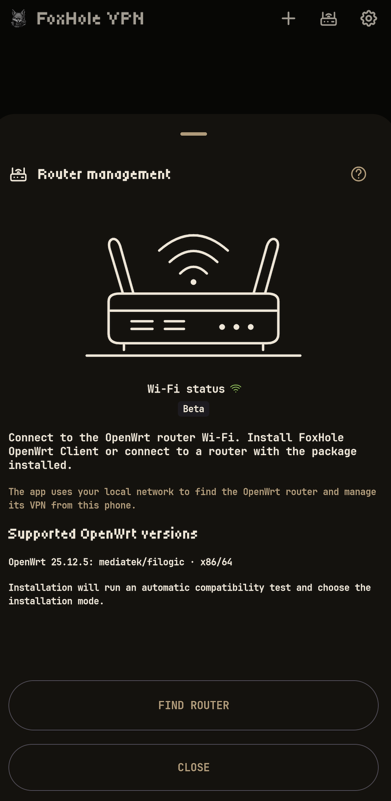

<p align="center">
    
</p>

<div align="center">

[](README.md)
[](docs/README.ru.md)
[](docs/README.de.md)
[](docs/README.fr.md)
[](docs/README.es.md)
[](docs/README.ja.md)
[](docs/README.zh-CN.md)

</div>

<p align="center">
  <a href="https://github.com/foxhole-team/foxhole-vpn/releases">
    
  </a>
  <a href="https://f-droid.org/packages/com.foxhole.vpn/">
    
  </a>
  <a href="https://apps.obtainium.imranr.dev/redirect?r=obtainium://app/%7B%22id%22%3A%22com.foxhole.vpn%22%2C%22url%22%3A%22https%3A%2F%2Fgithub.com%2Ffoxhole-team%2Ffoxhole-vpn%22%2C%22author%22%3A%22FoxHole%20Team%22%2C%22name%22%3A%22FoxHole%20VPN%22%2C%22preferredApkIndex%22%3A0%2C%22additionalSettings%22%3A%22%7B%5C%22apkFilterRegEx%5C%22%3A%5C%22arm64-v8a-release%5C%5C%5C%5C.apk%24%5C%22%2C%5C%22invertAPKFilter%5C%22%3Afalse%2C%5C%22verifyLatestTag%5C%22%3Atrue%7D%22%2C%22overrideSource%22%3A%22GitHub%22%7D">
    
  </a>
</p>

# FoxHole VPN


[](https://www.gnu.org/licenses/gpl-3.0.html)

[](https://github.com/foxhole-team/foxhole-vpn)


<p align="center">
  
  
  
</p>

FoxHole VPN is a simple VPN client for Android 8 and later. Import a profile from your VPN provider or your own server, connect on your phone, and manage a paired OpenWrt router from the app.

Supports VLESS, VMess, Trojan, Shadowsocks/Outline, WireGuard, AmneziaWG (experimental), Hysteria2, Naive, TUIC and AnyTLS. Imports compatible FoxHole Guard configurations, v2rayTun links and subscriptions, Clash/mihomo YAML, SIP008 JSON and dynamic Outline keys (`ssconf://`). Share profiles only with people you trust: exported profiles and source links may contain access credentials.

## 🤖 Supported platforms

Android 8 (API 26) or later is required. Build profiles can include `arm64-v8a`, `armeabi-v7a`, `x86` and `x86_64`; each published release lists its available APKs.

The current router package/update policy allows OpenWrt 25.12.5 targets `mediatek/filogic` and `x86/64`, subject to an authenticated catalog for the exact architecture, dependencies, kernel ABI and available flash/RAM. A target name does not establish compatibility with every router model.

## 🎛️ Everyday controls

- Import profiles from the clipboard, a file or a QR code; share saved profiles and refresh profiles that retain a subscription source.
- Select a protocol from the options in an imported profile. Changing the active profile’s protocol asks for confirmation before reconnecting.
- Home-screen widgets provide connection status and start/stop controls for the selected profile.
- Choose a theme and app language in Settings: English, Russian, German, French, Spanish, Japanese or Simplified Chinese.

When enabled in Settings → Background updates, subscriptions refresh about every 12 hours and signed connection-data updates from FoxHole DB are checked every 24 hours by default. Turn either background check off there. Data installation still requires your action. The GitHub build checks for app updates daily; downloading and installing an APK require your action and Android confirmation. The F-Droid build does not check for or install its own APK updates: use F-Droid. Android may delay background work.

## 🛜 Router management public beta

Router management is a public beta; device compatibility and installation/update workflows remain under validation.

> [!IMPORTANT]
> Automatic installation currently supports only routers with a completely default OpenWrt configuration.
> You can also pair a router after manually installing the latest [FoxHole OpenWrt Client](https://github.com/foxhole-team/foxhole-openwrt-client).
> For setup and pairing, the phone and router must be on the same LAN, and the router needs internet access.

`ACCESS_LOCAL_NETWORK` - router discovery, setup and management. On Android 17 (API 37) or later, when the app targets API 37 or later, the app requests the system permission before LAN actions. Denial blocks those actions.

The management switch applies to the selected saved pairing. Turning it off stops app management, not the router VPN; setup and pairing remain available for an unpaired router.

The Wi-Fi icon reports only a physical Wi-Fi connection, without an SSID or location access. Search and new setup/pairing require Wi-Fi. Manual entry is prefilled once with the current private IPv4 Wi-Fi gateway when available and stays editable.

Manage through home VPN is a separate opt-in, OFF by default for each existing pairing. It also requires your Public IP address confirmation (the router has a public IP and incoming VPN service) and a usable active VPN route. That confirmation does not assign an address or configure the firewall. The app can attempt foreground control through that VPN network at the saved private endpoint using the existing pinned TLS identity and paired authentication; it opens no WAN management port and does not enable discovery or new pairing over mobile data. Automatic phone VPN switching/handoff remains disabled; this opt-in concerns router management only.

Only incoming-VPN profiles delivered directly to the app by an authenticated paired router receive separate app-link metadata. Their connection URI, configuration and QR formats are unchanged. Generic web/QR/provider exports remain unmarked, and imported hints cannot establish trust.

Automatic recognition additionally requires the matching saved local profile, current configuration and selected pairing, with that profile actually connected through the app-owned VPN. It makes one bounded check per actual connection, with no timer, automatic retry or provider-profile polling. Retry pairing is an explicit Wi-Fi/permission/PIN flow: the old record remains until authentication succeeds, and a changed certificate identity is never accepted silently.

Before the first router installation, read the FoxHole OpenWRT Client agreement and explicitly accept it. This choice starts unchecked and is separate from automatic updates. Existing paired routers do not ask for retroactive acceptance.

Install the [FoxHole OpenWrt Client](https://github.com/foxhole-team/foxhole-openwrt-client) package, then manage router VPN profiles, device routing and protocol packages. Router setup requires OpenWrt 25.12.5 with the apk package manager and an authenticated release catalog for the exact router architecture; setup also verifies available storage. Published catalogs determine which targets are available. Installation needs router administrator access. Remote VPN profiles for your devices require a reachable public router address and configured incoming VPN. Check reachability from a mobile network.

During a new router installation, the visible automatic FoxHole update checkbox starts enabled. Clear it to opt out, or change it later in router Settings. When enabled, the router checks daily and installs verified FoxHole package updates from FoxHole releases, independently of F-Droid. Pairing an existing router preserves its policy. Updates preserve profiles and pairing, and do not upgrade OpenWrt firmware or unrelated system packages. Unpairing the phone does not turn off this router policy.

Manual FoxHole updates from the app and LuCI use the same authenticated transaction. Direct CLI/backend installations keep automatic updates off by default.

## 🔒 Privacy

Profiles and settings are encrypted on the device with an Android Keystore key. No advertising or analytics SDK is included. VPN connection checks contact `www.google.com/generate_204`, and exit-IP details come from `ipwho.is`; these requests use the selected VPN network. When VPN is off, approximate device location can be refreshed through the current internet connection, including by a widget. These services receive the request and its source IP address. Signed connection data comes from `foxhole-team.github.io/foxhole-db`; subscriptions use your saved provider URLs. No GPS location is needed.

## 📄 License

[GPL-3.0-or-later](LICENSE) · Copyright (C) 2026 FOXHOLE TEAM.

Component licenses are listed in Settings → About.

[Third-party components](THIRD_PARTY_NOTICES.md).

## 🔗 Related projects

[](https://github.com/foxhole-team/foxhole-core)
[](https://github.com/foxhole-team/foxhole-core/releases)

[](https://github.com/foxhole-team/foxhole-db)
[](https://github.com/foxhole-team/foxhole-db/releases)

[](https://github.com/foxhole-team/foxhole-guard)
[](https://github.com/foxhole-team/foxhole-guard/releases)

[](https://github.com/foxhole-team/foxhole-openwrt-client)
[](https://github.com/foxhole-team/foxhole-openwrt-client/releases)

## 📦 Release availability

Available APK architectures and router targets are listed in each published release. A build option or source recipe does not establish device compatibility or F-Droid availability; F-Droid inclusion remains subject to its review.

## 💖 Support development

We develop and maintain FoxHole VPN entirely with our own time and resources, with help from AI tools. Your support helps us dedicate more time to the project and speed up development.

[Support the project - cryptocurrency wallets](#cryptocurrency-wallets)

<a id="cryptocurrency-wallets"></a>

### 🪙 Cryptocurrency wallets

**XMR (Monero):**

```text
48yBVPTdcyJ1WoJtnKmVpEZziEsDy4HvbCW7eQDS9mfdiWPFXwZ8F5h9YZ2UTTBLxPcJgQgvth7iqLZM2yMCaQ432qaouqr
```

**BTC (Bitcoin):**

```text
bc1qatnyy7jcpqrp0d3dk9rta9vqfejgh4mysd6m2f
```

**ETH (Ethereum):**

```text
0xDEBA357Cc8f5E865ea7FFa98E138C8241A16A465
```
