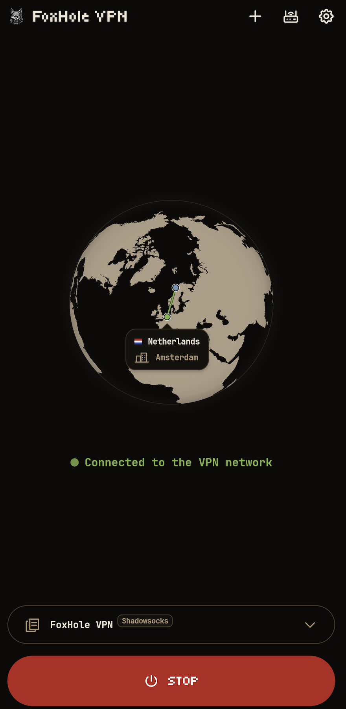
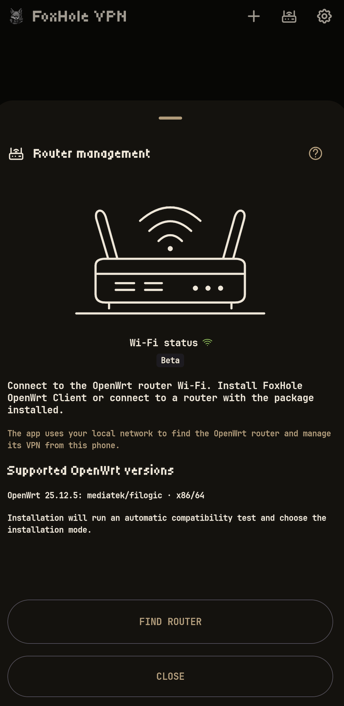
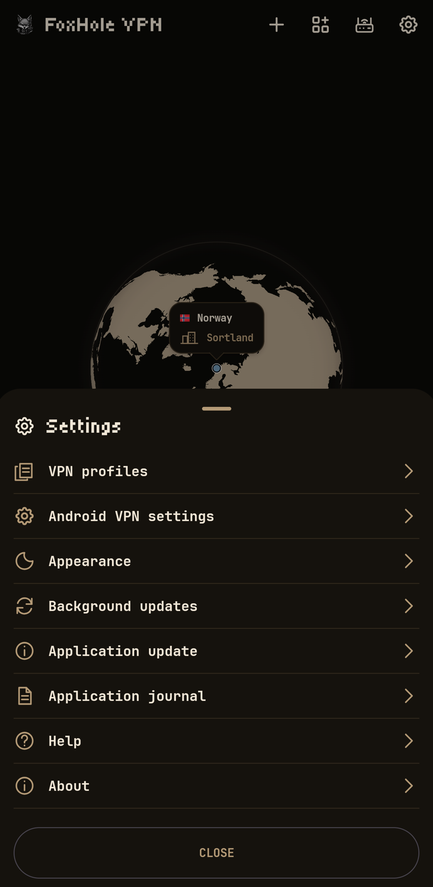

<h1 align="center">FoxHole VPN</h1>

<a id="whats-new"></a>

> **🆕 What's new - 1.0.3 Stable**
>
> - Added Routing (beta) for simple per-app traffic routing with atomic rule updates.
> - Fixed DNS routing in application scenarios.
> - The widget now shows the current routing scenario with color indication.
> - Optimized the interface: fixed country flag display, selection list colors, and window animations.
> - Improved documentation and the help section in all supported languages.
> - Added the application log.
> - The application interface is now more compact.
> - Added system notifications for new app versions (GitHub version only).

<div align="center">

FoxHole VPN is a simple VPN client for Android 8 and later. Import a profile from your VPN provider or your own server, connect on your phone, and manage a paired OpenWrt router from the app.

</div>

<p align="center">
    
</p>

<div align="center">

[](README.md)
[](docs/README.ru.md)
[](docs/README.de.md)
[](docs/README.fr.md)
[](docs/README.es.md)
[](docs/README.ja.md)
[](docs/README.zh-CN.md)

</div>

<p align="center">
  <a href="https://github.com/foxhole-team/foxhole-vpn/releases">
    
  </a>
  
  <a href="https://f-droid.org/packages/com.foxhole.vpn/">
    
  </a>
  <a href="https://apps.obtainium.imranr.dev/redirect?r=obtainium://app/%7B%22id%22%3A%22com.foxhole.vpn%22%2C%22url%22%3A%22https%3A%2F%2Fgithub.com%2Ffoxhole-team%2Ffoxhole-vpn%22%2C%22author%22%3A%22FoxHole%20Team%22%2C%22name%22%3A%22FoxHole%20VPN%22%2C%22preferredApkIndex%22%3A0%2C%22additionalSettings%22%3A%22%7B%5C%22apkFilterRegEx%5C%22%3A%5C%22arm64-v8a%5B.%5Dapk%24%5C%22%2C%5C%22invertAPKFilter%5C%22%3Afalse%2C%5C%22verifyLatestTag%5C%22%3Atrue%7D%22%2C%22overrideSource%22%3A%22GitHub%22%7D" title="Obtainium · ARM64">
    
  </a>
</p>


[](https://www.gnu.org/licenses/gpl-3.0.html)


Supports VLESS, VMess, Trojan, Shadowsocks/Outline, WireGuard, AmneziaWG (experimental), Hysteria2, Naive, TUIC and AnyTLS. Imports compatible FoxHole Guard configurations, v2rayTun links and subscriptions, Clash/mihomo YAML, SIP008 JSON and dynamic Outline keys (`ssconf://`). Share profiles only with people you trust: exported profiles and source links may contain access credentials.

Import transfers supported connection parameters. Clash/mihomo routing rules and other client settings are not transferred; external `proxy-providers` are unsupported. Compatibility with FoxHole Guard profiles concerns the VPN connection and does not transfer Tor, I2P, firewall settings or Guard scenarios.

<p align="center"><a href="#quickstart">Get started</a> · <a href="#features">Features</a> · <a href="#details">Details</a> · <a href="#whats-new">What's new</a></p>


<a id="quickstart"></a>

## ⬇️ Get started and download

Android 8 (API 26) or later is required. Choose the APK architecture listed in the published release.

1. Choose your APK architecture in [GitHub Releases](https://github.com/foxhole-team/foxhole-vpn/releases).
2. Import a profile from your own server or provider using a file, clipboard or QR code.
3. Connect and approve Android’s system VPN request.

Obtainium · ARM64. For other architectures, choose an APK in [GitHub Releases](https://github.com/foxhole-team/foxhole-vpn/releases).

<p align="center">
  
  
  
</p>

## 🤖 Supported platforms

Android 8 (API 26) or later is required. Build profiles can include `arm64-v8a`, `armeabi-v7a`, `x86` and `x86_64`; each published release lists its available APKs.

The current router package/update policy allows OpenWrt 25.12.5 targets `mediatek/filogic` and `x86/64`, subject to an authenticated catalog for the exact architecture, dependencies, kernel ABI and available flash/RAM. A target name does not establish compatibility with every router model.

## 📦 Release availability

Available APK architectures and router targets are listed in each published release. A build option or source recipe does not establish device compatibility or F-Droid availability; F-Droid inclusion remains subject to its review.

<a id="features"></a>

## 🎛️ Everyday controls

- Import profiles from the clipboard, a file or a QR code; share saved profiles and refresh profiles that retain a subscription source.
- Select a protocol from the options in an imported profile. Changing the active profile’s protocol asks for confirmation before reconnecting.
- Choose a routing scenario for the whole device or selected applications, with VPN and Direct rules.
- Home-screen widgets provide connection status and start/stop controls for the selected profile.
- Choose a theme and app language in Settings: English, Russian, German, French, Spanish, Japanese or Simplified Chinese.

Scenarios use Android’s VPN application routing for every supported profile protocol on Android 8.0 (API 26) and later. Whole device ignores app rules. In Proxy, the Whole device switch controls the default for unlisted apps: on sends them through VPN, off sends only explicit VPN rules through VPN. A Direct rule uses the device’s normal connection and system DNS settings, including Private DNS. These app-owned rules are separate from imported profiles.

The application picker shows selected apps first and filters all, system, or user apps, with user apps selected by default. Press and hold an application rule to remove it after confirmation. Successful scenario changes and live rule updates show a brief confirmation with haptic feedback.

Installed-app visibility is used locally to populate routing rules, including system applications.

Atomic application is enabled by default. Before saving changes to active routing, the app establishes a temporary VPN interface covering the whole device to block traffic. After the new encrypted settings are committed, it applies the target Android application scope and reconnects VPN when needed. If a change cannot be completed safely, stop VPN before trying again. Confirmation is disabled by default. A stopped VPN stays stopped.

When enabled in Settings → Background updates, subscriptions refresh about every 12 hours and signed TLS fingerprint tables from FoxHole DB are checked every 24 hours by default. Turn either background check off there. Data installation still requires your action. The GitHub build checks for app updates daily; downloading and installing an APK require your action and Android confirmation. The F-Droid build does not check for or install its own APK updates: use F-Droid. Android may delay background work.

These updates change the data used by the core to form TLS ClientHello. Installing a verified update requires your action.

<a id="details"></a>

## 🛜 Router management public beta

> [!NOTE]
> Router management while a VPN connection is active is not yet supported.

Router management is a public beta; device compatibility and installation/update workflows remain under validation.

> [!IMPORTANT]
> The restrictions below describe the current published release.
> Automatic installation currently supports only routers with a completely default OpenWrt configuration.
> You can also pair a router after manually installing the latest [FoxHole OpenWrt Client](https://github.com/foxhole-team/foxhole-openwrt-client).
> For setup and pairing, the phone and router must be on the same LAN, and the router needs internet access.

`ACCESS_LOCAL_NETWORK` - router discovery, setup and management. On Android 17 (API 37) or later, when the app targets API 37 or later, the app requests the system permission before LAN actions. Denial blocks those actions.

The management switch applies to the selected saved pairing. Turning it off stops app management, not the router VPN; setup and pairing remain available for an unpaired router.

The Wi-Fi icon reports only a physical Wi-Fi connection, without an SSID or location access. Search and new setup/pairing require Wi-Fi. Manual entry is prefilled once with the current private IPv4 Wi-Fi gateway when available and stays editable.

Manage through home VPN is a separate opt-in, OFF by default for each existing pairing. It also requires your Public IP address confirmation (the router has a public IP and incoming VPN service) and a usable active VPN route. That confirmation does not assign an address or configure the firewall. The app can attempt foreground control through that VPN network at the saved private endpoint using the existing pinned TLS identity and paired authentication; it opens no WAN management port and does not enable discovery or new pairing over mobile data. Automatic phone VPN switching/handoff remains disabled; this opt-in concerns router management only.

<details>
<summary>Router management details</summary>

Only incoming-VPN profiles delivered directly to the app by an authenticated paired router receive separate app-link metadata. Their connection URI, configuration and QR formats are unchanged. Generic web/QR/provider exports remain unmarked, and imported hints cannot establish trust.

Automatic recognition additionally requires the matching saved local profile, current configuration and selected pairing, with that profile actually connected through the app-owned VPN. It makes one bounded check per actual connection, with no timer, automatic retry or provider-profile polling. Retry pairing is an explicit Wi-Fi/permission/PIN flow: the old record remains until authentication succeeds, and a changed certificate identity is never accepted silently.

Before the first router installation, read the FoxHole OpenWRT Client agreement and explicitly accept it. This choice starts unchecked and is separate from automatic updates. Existing paired routers do not ask for retroactive acceptance.

Install the [FoxHole OpenWrt Client](https://github.com/foxhole-team/foxhole-openwrt-client) package, then manage router VPN profiles, device routing and protocol packages. Router setup requires OpenWrt 25.12.5 with the apk package manager and an authenticated release catalog for the exact router architecture; setup also verifies available storage. Published catalogs determine which targets are available. Installation needs router administrator access. Remote VPN profiles for your devices require a reachable public router address and configured incoming VPN. Check reachability from a mobile network.

During a new router installation, the visible automatic FoxHole update checkbox starts enabled. Clear it to opt out, or change it later in router Settings. When enabled, the router checks daily and installs verified FoxHole package updates from FoxHole releases, independently of F-Droid. Pairing an existing router preserves its policy. Updates preserve profiles and pairing, and do not upgrade OpenWrt firmware or unrelated system packages. Unpairing the phone does not turn off this router policy.

Manual FoxHole updates from the app and LuCI use the same authenticated transaction. Direct CLI/backend installations keep automatic updates off by default.


</details>

## 🔒 Privacy

Profiles and settings are encrypted on the device with an Android Keystore key. No advertising or analytics SDK is included. VPN connection checks contact `www.google.com/generate_204`, and exit-IP details come from `ipwho.is`; these requests use the selected VPN network. When VPN is off, approximate device location can be refreshed through the current internet connection, including by a widget. These services receive the request and its source IP address. Signed TLS fingerprint tables comes from `foxhole-team.github.io/foxhole-db`; subscriptions use your saved provider URLs. No GPS location is needed.

<a id="ecosystem"></a>

## 🔗 FoxHole ecosystem

| Project | Role |
| --- | --- |
| [FoxHole Guard](https://github.com/foxhole-team/foxhole-guard) | Android: VPN, Tor/I2P, traffic rules and local monitoring |
| [**FoxHole VPN**](https://github.com/foxhole-team/foxhole-vpn) | Android: simple VPN client and paired OpenWrt management |
| [FoxHole Core](https://github.com/foxhole-team/foxhole-core) | Shared Rust networking core; features depend on the build |
| [FoxHole OpenWrt](https://github.com/foxhole-team/foxhole-openwrt-client) | Router VPN and local-network management |
| [FoxHole DB](https://github.com/foxhole-team/foxhole-db) | Signed rules and reference datasets |

## 🤝 Contributing

Report bugs and propose changes through [Issues](https://github.com/foxhole-team/foxhole-vpn/issues).

## 💖 Support development

We develop and maintain FoxHole VPN entirely with our own time and resources, using AI tools in development. Your support helps us dedicate more time to the project and speed up development.

<a id="cryptocurrency-wallets"></a>

### 🪙 Cryptocurrency wallets

**XMR (Monero):**

```text
48yBVPTdcyJ1WoJtnKmVpEZziEsDy4HvbCW7eQDS9mfdiWPFXwZ8F5h9YZ2UTTBLxPcJgQgvth7iqLZM2yMCaQ432qaouqr
```

**BTC (Bitcoin):**

```text
bc1qatnyy7jcpqrp0d3dk9rta9vqfejgh4mysd6m2f
```

**ETH (Ethereum):**

```text
0xDEBA357Cc8f5E865ea7FFa98E138C8241A16A465
```

## 📄 License

[GPL-3.0-or-later](LICENSE) · Copyright (C) 2026 FOXHOLE TEAM.

Component licenses are listed in Settings → About.

[Third-party components](THIRD_PARTY_NOTICES.md).

## Roadmap

See [Roadmap](ROADMAP.md) for project priorities and [TODO](TODO.md) for planned work.
