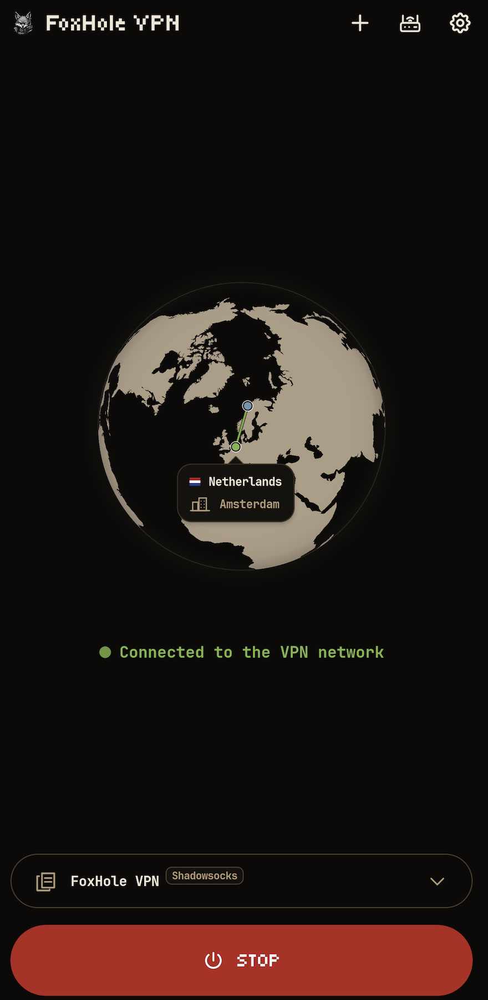
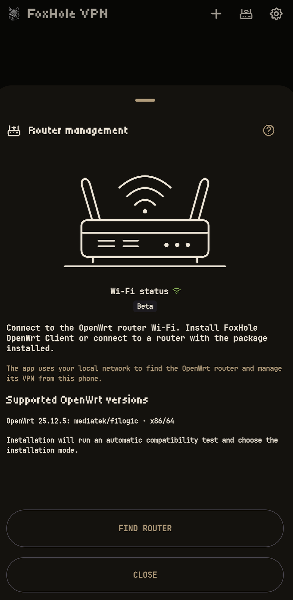
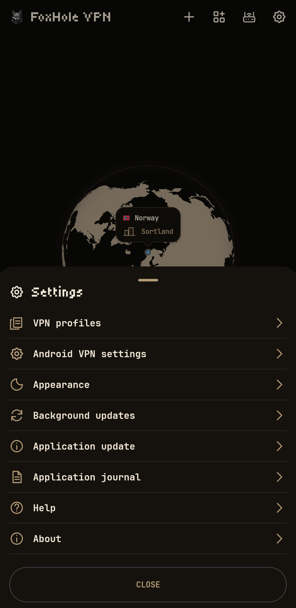

<h1 align="center">FoxHole VPN</h1>

عميل VPN بسيط لنظام Android 7 أو أحدث. استورد ملفًا شخصيًا من مزوّد VPN أو خادمك، واتصل من هاتفك، وأدِر موجّه OpenWrt مقترنًا من التطبيق.

[English](../README.md) · [Русский](README.ru.md) · [Deutsch](README.de.md) · [Français](README.fr.md) · [Español](README.es.md) · [日本語](README.ja.md) · [简体中文](README.zh-CN.md) · [العربية](README.ar.md)

> **ما الجديد — 1.0.5 Stable**
>
> - أُضيف دعم Android 7.
> - أُضيف توجيه حركة بيانات مواقع الويب.
> - تحسين النمط المرئي للإشعارات.

## البدء والتنزيل

1. اختر APK المناسب لمعمارية جهازك من [إصدارات GitHub](https://github.com/foxhole-team/foxhole-vpn/releases).
2. استورد ملفًا شخصيًا من خادمك أو مزوّدك عبر ملف أو الحافظة أو رمز QR.
3. اضغط بدء ووافق على طلب VPN في نظام Android.

يتطلب الإصدار المنشور Android 7 (API 24) أو أحدث. يمكن أن تتضمن إعدادات البناء `arm64-v8a` و`armeabi-v7a` و`x86` و`x86_64`؛ يحدد كل إصدار منشور ملفات APK المتاحة. وجود وصفة مصدر أو خيار بناء لا يثبت توافق الأجهزة أو توفر التطبيق في F-Droid؛ يظل الإدراج خاضعًا لمراجعته.

## الملفات الشخصية والبروتوكولات

يدعم التطبيق VLESS وVMess وTrojan وShadowsocks/Outline وWireGuard وAmneziaWG (تجريبي) وHysteria2 وNaive وTUIC وAnyTLS. يستورد إعدادات FoxHole Guard المتوافقة وروابط واشتراكات v2rayTun وClash/mihomo YAML وSIP008 JSON ومفاتيح Outline الديناميكية (`ssconf://`).

ينقل الاستيراد معلمات الاتصال المدعومة فقط. لا تُنقَل قواعد توجيه Clash/mihomo أو إعدادات العميل الأخرى، ولا يُدعَم `proxy-providers` الخارجي. التوافق مع ملفات FoxHole Guard الشخصية يتعلق باتصال VPN، ولا ينقل Tor أو I2P أو إعدادات جدار الحماية أو سيناريوهات Guard.

اضغط مطولًا على ملف محفوظ لإدارته أو مشاركته أو تحديثه أو حذفه أو إرساله إلى موجّه مقترن. قد تحتوي الملفات المصدّرة وروابط المصدر على بيانات اعتماد وصول؛ شاركها فقط مع أشخاص تثق بهم. يمكن تحديث الملفات التي تحتفظ بمصدر الاشتراك. يتطلب تغيير بروتوكول الملف النشط تأكيدًا قبل إعادة الاتصال.

## التوجيه والأدوات

| السيناريو | السلوك |
| --- | --- |
| الجهاز بالكامل | يمر كل المرور عبر VPN، وتُتجاهل قواعد التطبيقات. |
| الوكيل، مع تفعيل الجهاز بالكامل | تستخدم التطبيقات غير المدرجة VPN، وتُطبَّق استثناءات الاتصال المباشر. |
| الوكيل، مع تعطيل الجهاز بالكامل | تستخدم VPN فقط التطبيقات التي لها قاعدة VPN صريحة. |
| قاعدة الاتصال المباشر | تستخدم اتصال الجهاز المعتاد وDNS النظام، بما فيه DNS الخاص. |

تستخدم السيناريوهات توجيه تطبيقات Android VPN لجميع بروتوكولات الملفات المدعومة على API 24 أو أحدث. هذه قواعد خاصة بالتطبيق، منفصلة عن إعدادات الملفات المستوردة.

يعرض منتقي التطبيقات المختار منها أولًا، مع تصفية الكل أو تطبيقات النظام أو المستخدم؛ وتظهر تطبيقات المستخدم افتراضيًا. اضغط مطولًا على قاعدة لإزالتها بعد التأكيد. تُستخدم رؤية التطبيقات المثبتة محليًا لملء قائمة القواعد. تظهر تأكيدات قصيرة مع اهتزاز عند نجاح تغيير سيناريو أو تحديث قواعد نشطة.

التطبيق الذرّي مفعّل افتراضيًا. قبل حفظ تغيير التوجيه النشط، ينشئ التطبيق واجهة VPN مؤقتة تشمل الجهاز بالكامل لحظر حركة البيانات. بعد حفظ الإعدادات المشفّرة الجديدة، يطبّق نطاق تطبيقات Android المستهدف ويعيد اتصال VPN عند الحاجة. إذا تعذر إكمال التغيير بأمان، أوقف VPN قبل المحاولة مجددًا. التأكيد معطّل افتراضيًا؛ ولا يبدأ VPN المتوقف تلقائيًا.

توفر أدوات الشاشة الرئيسية حالة الاتصال والتحكم ببدئه وإيقافه. تتيح الإعدادات تغيير السمة واللغة والخط، وسجل التطبيق مع حفظه وتنظيفه.

## التحديثات

عند التفعيل في الإعدادات ← التحديثات في الخلفية، تُحدَّث الاشتراكات كل 12 ساعة تقريبًا، ويُتحقق من جداول بصمات TLS الموقّعة من FoxHole DB كل 24 ساعة افتراضيًا. يمكنك تعطيل كل فحص منفصلًا. يظل تثبيت البيانات بحاجة إلى إجراء منك؛ وهي تغيّر البيانات التي تستخدمها النواة لتكوين TLS ClientHello.

تتحقق نسخة GitHub من تحديثات التطبيق يوميًا؛ ويتطلب تنزيل APK وتثبيته إجراء منك وتأكيد Android. لا تفحص نسخة F-Droid تحديثات APK الخاصة بها ولا تثبّتها؛ استخدم F-Droid. قد يؤخر Android العمل في الخلفية.

## إدارة الموجّه — نسخة تجريبية عامة

إدارة الموجّه ميزة تجريبية عامة؛ لا تزال توافقية الأجهزة ومسارات التثبيت والتحديث قيد التحقق. تصف القيود التالية الإصدار المنشور الحالي، ولا تمثّل قبولًا تشغيليًا لكل جهاز.

> إدارة الموجّه أثناء نشاط اتصال VPN غير مدعومة بعد في الإصدار المنشور.

يدعم التثبيت التلقائي المنشور حاليًا الموجّهات ذات إعداد OpenWrt الافتراضي بالكامل فقط. يمكنك أيضًا الاقتران بموجّه بعد تثبيت أحدث [FoxHole OpenWrt Client](https://github.com/foxhole-team/foxhole-openwrt-client) يدويًا. يجب أن يكون الهاتف والموجّه على LAN نفسها للإعداد والاقتران، وأن يتوفر الإنترنت للموجّه.

تسمح سياسة الحزم الحالية بأهداف OpenWrt 25.12.5 من نوع `mediatek/filogic` و`x86/64`، بشرط وجود كتالوج موثَّق للمعمارية والتبعيات وABI النواة ومساحة flash/RAM بالضبط. لا يثبت اسم الهدف التوافق مع كل طراز. يلزم وصول مسؤول الموجّه للتثبيت. تُراجَع هوية SSH وهوية TLS المحلية الخاصة قبل الاقتران؛ ولا تُقبَل شهادة متغيرة بصمت.

يخص مفتاح الإدارة الاقتران المحفوظ المختار. يؤدي إيقافه إلى إيقاف إدارة التطبيق، لا VPN الموجّه. تبقى إمكانية إعداد موجّه غير مقترن أو الاقتران به متاحة. يعرض رمز Wi-Fi الاتصال الفيزيائي فقط، دون اسم الشبكة أو الوصول إلى الموقع. تتطلب عمليات البحث والإعداد والاقتران الجديدة Wi-Fi. يُملأ العنوان اليدوي مرة واحدة ببوابة IPv4 الخاصة الحالية عند توفرها، ويبقى قابلًا للتحرير.

يُستخدم إذن `ACCESS_LOCAL_NETWORK` للاكتشاف والإعداد والإدارة. على Android 17 (API 37) أو أحدث، عندما يستهدف التطبيق API 37 أو أحدث، يطلب إذن النظام قبل إجراءات LAN؛ ويمنع الرفض تلك الإجراءات.

الإدارة عبر VPN المنزلي موافقة اختيارية منفصلة، معطّلة افتراضيًا لكل اقتران موجود. تتطلب أيضًا تأكيدك أن للموجّه عنوان IP عامًا وخدمة VPN واردة، ومسار VPN نشطًا صالحًا. لا يعيّن التأكيد عنوانًا ولا يعِد جدار الحماية. يمكن للتطبيق محاولة الإدارة في المقدمة عبر شبكة VPN تلك إلى نقطة النهاية الخاصة المحفوظة باستخدام هوية TLS المثبتة والمصادقة المقترنة الحالية؛ لا يفتح منفذ إدارة WAN، ولا يتيح الاكتشاف أو الاقتران الجديد عبر الجوال. يظل التبديل التلقائي لـ VPN الهاتف وتسليمه معطّلًا؛ ويخص هذا الخيار الإدارة فقط.

لا تحصل على بيانات ارتباط التطبيق المنفصلة إلا ملفات VPN الوارد التي يسلّمها موجّه مقترن موثَّق مباشرةً. لا تتغير صيغ URI والإعدادات وQR. تظل الصادرات العامة غير معلَّمة، ولا تنشئ تلميحات الاستيراد ثقة. يتطلب التعرف التلقائي أيضًا تطابق الملف المحلي المحفوظ وإعداداته الحالية والاقتران المختار، مع اتصاله الفعلي عبر VPN التطبيق. يُجرى فحص محدود واحد لكل اتصال فعلي، دون مؤقت أو إعادة تلقائية أو استقصاء ملفات المزوّد. تبقى بيانات الاقتران القديمة حتى نجاح المصادقة في إجراء إعادة الاقتران الصريح.

قبل التثبيت الأول، يجب قراءة اتفاقية FoxHole OpenWRT Client وقبولها صراحةً. تبدأ خانة الموافقة غير محددة وهي منفصلة عن التحديث التلقائي؛ ولا يُطلب قبول بأثر رجعي من الموجّهات المقترنة.

في تثبيت جديد من الهاتف، يبدأ خيار تحديث FoxHole التلقائي مفعّلًا. ألغِ تحديده لتعطيله أو غيّره لاحقًا في إعدادات الموجّه. يتحقق الموجّه يوميًا ويثبّت الحزم المتحقق منها مستقلًا عن F-Droid. يحافظ اقتران موجّه موجود على سياسته، ولا يعطّل إلغاء اقتران الهاتف تلك السياسة. تحفظ التحديثات الملفات الشخصية والاقتران؛ ولا تحدّث نظام OpenWrt أو الحزم غير المرتبطة. تستخدم التحديثات اليدوية من التطبيق وLuCI المعاملة الموثَّقة نفسها. يبقى التحديث التلقائي معطّلًا افتراضيًا في تثبيت CLI/الخلفية المباشر.

يلزم عنوان عام يمكن الوصول إليه وخدمة VPN واردة مُعَدّة لإنشاء ملفات VPN بعيدة لأجهزتك. تحقق من الوصول عبر شبكة الجوال. يلغي إلغاء الاقتران الإدارة فقط؛ احذف العميل منفصلًا لإلغاء وصول VPN.

## الخصوصية

تُشفَّر الملفات الشخصية والإعدادات محليًا بمفتاح Android Keystore. لا توجد حزم SDK للإعلانات أو التحليلات. تتصل فحوص VPN بـ `www.google.com/generate_204`، وتأتي معلومات IP الخروج من `ipwho.is`؛ وتستخدم تلك الطلبات شبكة VPN المختارة. عند إيقاف VPN، يمكن تحديث الموقع التقريبي عبر اتصال الإنترنت الحالي، بما فيه عبر الأداة. ترى تلك الخدمات الطلب وعنوان IP المصدر. تأتي جداول بصمات TLS الموقّعة من `foxhole-team.github.io/foxhole-db`؛ وتستخدم الاشتراكات روابط مزوّديك المحفوظة. لا يلزم موقع GPS.

## منظومة FoxHole

| المشروع | الدور |
| --- | --- |
| [FoxHole Guard](https://github.com/foxhole-team/foxhole-guard) | VPN وTor/I2P وقواعد حركة البيانات والمراقبة المحلية على Android |
| [FoxHole VPN](https://github.com/foxhole-team/foxhole-vpn) | عميل VPN بسيط وإدارة OpenWrt مقترن |
| [FoxHole Core](https://github.com/foxhole-team/foxhole-core) | نواة شبكة مشتركة بلغة Rust؛ تختلف الميزات حسب البناء |
| [FoxHole OpenWrt](https://github.com/foxhole-team/foxhole-openwrt-client) | VPN الموجّه وإدارة الشبكة المحلية |
| [FoxHole DB](https://github.com/foxhole-team/foxhole-db) | مجموعات بيانات وقواعد مرجعية موقّعة |

## المساهمة والدعم والترخيص

أبلغ عن الأخطاء واقترح التغييرات عبر [Issues](https://github.com/foxhole-team/foxhole-vpn/issues). نطوّر FoxHole VPN ونصونه بوقتنا ومواردنا الخاصة، مع استخدام أدوات الذكاء الاصطناعي في التطوير. يساعد دعمك في تخصيص وقت أكبر للمشروع وتسريع التطوير. تتوفر [وسائل الدعم والمحافظ](../README.md#cryptocurrency-wallets) في الصفحة الرئيسية.

[GPL-3.0-or-later](../LICENSE) · Copyright (C) 2026 FOXHOLE TEAM. تراخيص المكونات في الإعدادات ← حول التطبيق، وفي [إشعارات الأطراف الثالثة](../THIRD_PARTY_NOTICES.md).

راجع [خارطة الطريق](ROADMAP.ar.md) و[TODO بالإنجليزية](../TODO.md) للعمل المخطط.
