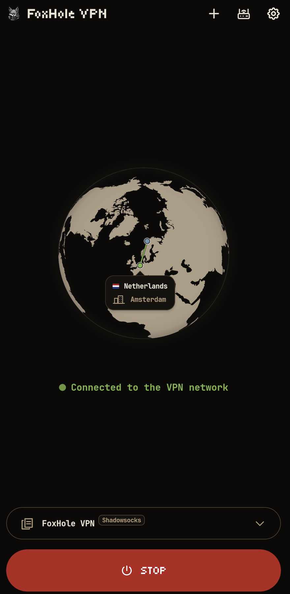
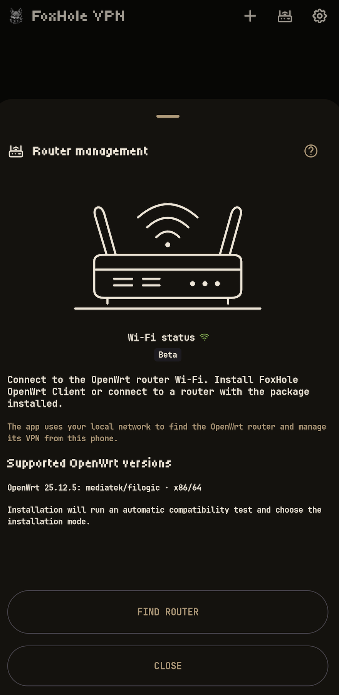
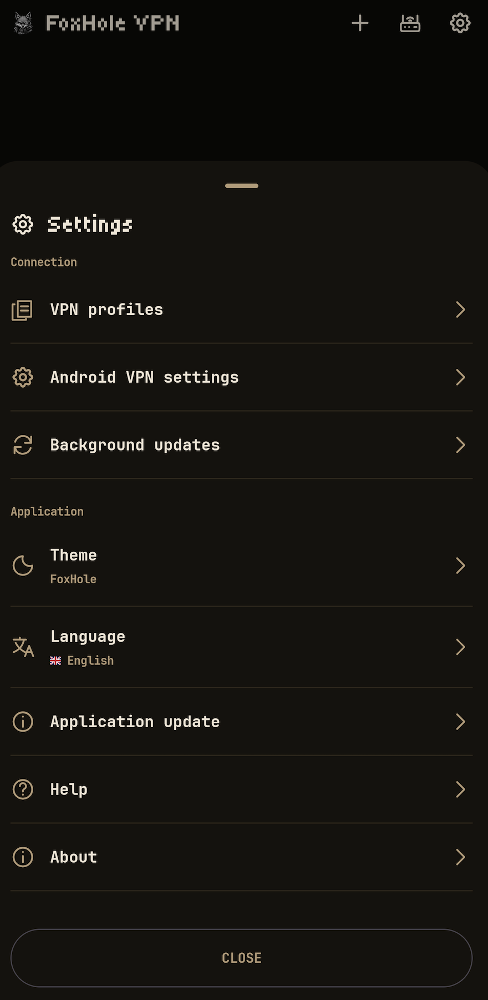

<h1 align="center">FoxHole VPN</h1>

<a id="whats-new"></a>

> **🆕 Novedades - 1.0.3 Stable**
>
> - Se ha añadido la sección «Enrutamiento» (beta) para enrutar fácilmente el tráfico por aplicación con aplicación atómica de los cambios.
> - Se ha corregido el enrutamiento DNS en los escenarios de la aplicación.
> - El widget muestra ahora el escenario de enrutamiento actual con indicación de color.
> - Se ha optimizado la interfaz: se han corregido las banderas de los países, los colores de las listas de selección y las animaciones de las ventanas.
> - Se han mejorado la documentación y la sección de ayuda en todos los idiomas compatibles.
> - Se ha añadido el registro de la aplicación.
> - La interfaz de la aplicación es ahora más compacta.
> - Se han añadido notificaciones del sistema sobre nuevas versiones de la aplicación (solo en la versión de GitHub).

<div align="center">

FoxHole VPN es un cliente VPN sencillo para Android 8 y posteriores. Importe un perfil de su proveedor VPN o servidor propio, conecte el teléfono y gestione un router OpenWrt vinculado desde la aplicación.

</div>

<p align="center">
    
</p>

<div align="center">

[](../README.md)
[](README.ru.md)
[](README.de.md)
[](README.fr.md)
[](README.es.md)
[](README.ja.md)
[](README.zh-CN.md)

</div>

<p align="center">
  <a href="https://github.com/foxhole-team/foxhole-vpn/releases">
    
  </a>
  
  <a href="https://f-droid.org/packages/com.foxhole.vpn/">
    
  </a>
  <a href="https://apps.obtainium.imranr.dev/redirect?r=obtainium://app/%7B%22id%22%3A%22com.foxhole.vpn%22%2C%22url%22%3A%22https%3A%2F%2Fgithub.com%2Ffoxhole-team%2Ffoxhole-vpn%22%2C%22author%22%3A%22FoxHole%20Team%22%2C%22name%22%3A%22FoxHole%20VPN%22%2C%22preferredApkIndex%22%3A0%2C%22additionalSettings%22%3A%22%7B%5C%22apkFilterRegEx%5C%22%3A%5C%22arm64-v8a%5B.%5Dapk%24%5C%22%2C%5C%22invertAPKFilter%5C%22%3Afalse%2C%5C%22verifyLatestTag%5C%22%3Atrue%7D%22%2C%22overrideSource%22%3A%22GitHub%22%7D" title="Obtainium · ARM64">
    
  </a>
</p>


Compatible con VLESS, VMess, Trojan, Shadowsocks/Outline, WireGuard, AmneziaWG (experimental), Hysteria2, Naive, TUIC y AnyTLS. Importa configuraciones compatibles de FoxHole Guard, enlaces y suscripciones v2rayTun, YAML de Clash/mihomo, JSON SIP008 y claves dinámicas Outline (`ssconf://`). Comparta perfiles solo con personas de confianza: los perfiles exportados y sus enlaces de origen pueden incluir credenciales.

La importación transfiere parámetros de conexión compatibles. No transfiere reglas ni otros ajustes del cliente Clash/mihomo; los `proxy-providers` externos no están admitidos. La compatibilidad con perfiles Guard se refiere a la conexión VPN y no transfiere Tor, I2P, el cortafuegos ni los escenarios Guard.

<p align="center"><a href="#quickstart">Empezar</a> · <a href="#features">Funciones</a> · <a href="#details">Detalles</a> · <a href="#whats-new">Novedades</a></p>


<a id="quickstart"></a>

## ⬇️ Inicio y descarga

Se necesita Android 8 (API 26) o posterior. Las arquitecturas APK disponibles se indican en cada versión publicada.

1. Elija su arquitectura APK en [GitHub Releases](https://github.com/foxhole-team/foxhole-vpn/releases).
2. Importe un perfil de su servidor o proveedor mediante archivo, portapapeles o QR.
3. Conecte y confirme la solicitud VPN de Android.

Obtainium · ARM64. Para otras arquitecturas, elija el APK en [GitHub Releases](https://github.com/foxhole-team/foxhole-vpn/releases).

<p align="center">
  
  
  
</p>

## 🤖 Plataformas compatibles

Se requiere Android 8 (API 26) o posterior. Los perfiles de compilación pueden incluir `arm64-v8a`, `armeabi-v7a`, `x86` y `x86_64`; cada versión publicada enumera sus APK disponibles.

La política actual de paquetes y actualizaciones del router admite OpenWrt 25.12.5 en `mediatek/filogic` y `x86/64`, con un catálogo autenticado para la arquitectura exacta, dependencias y ABI del kernel compatibles, y suficiente flash/RAM. Un nombre de destino no valida todos los modelos de router.

## 📦 Disponibilidad de versiones

Cada versión publicada enumera las arquitecturas APK y los destinos de router disponibles. Una opción de compilación o receta de código fuente no demuestra compatibilidad con un dispositivo ni disponibilidad en F-Droid; la inclusión en F-Droid depende de su revisión.

<a id="features"></a>

## 🎛️ Controles cotidianos

- Importe perfiles desde el portapapeles, un archivo o un código QR; comparta perfiles guardados y actualice los que conservan una fuente de suscripción.
- Seleccione un protocolo entre las opciones de un perfil importado. Cambiar el protocolo del perfil activo exige confirmación antes de reconectar.
- Los widgets de la pantalla de inicio muestran el estado de conexión y permiten iniciar o detener el perfil seleccionado.
- Elija tema e idioma en Ajustes: inglés, ruso, alemán, francés, español, japonés o chino simplificado.

Si se activan en Ajustes → Actualizaciones en segundo plano, las suscripciones se actualizan por defecto aproximadamente cada 12 horas y las tablas firmadas de huellas TLS de FoxHole DB se comprueban cada 24 horas. Allí puede desactivar cada comprobación por separado. Instalar los datos sigue requiriendo su acción. La versión GitHub comprueba actualizaciones de la aplicación cada día; descargar e instalar un APK requiere su acción y confirmación de Android. La versión F-Droid no comprueba ni instala sus propias actualizaciones APK: utilice F-Droid. Android puede retrasar las tareas en segundo plano.

Estas actualizaciones cambian los datos usados por el núcleo para formar TLS ClientHello. Instalar una actualización verificada requiere su acción.

<a id="details"></a>

## 🛜 Gestión del router (beta pública)

> [!NOTE]
> La gestión del router mientras hay una conexión VPN activa aún no es compatible.

La gestión del router está en beta pública. La compatibilidad de dispositivos y los procesos de instalación y actualización siguen en validación.

> [!IMPORTANT]
> Las restricciones siguientes corresponden a la versión publicada actual.
> La instalación automática actualmente solo admite routers con la configuración predeterminada de OpenWrt, sin modificaciones.
> También puede vincular un router después de instalar manualmente la última versión de [FoxHole OpenWrt Client](https://github.com/foxhole-team/foxhole-openwrt-client).
> Para la instalación y la vinculación, el teléfono y el router deben estar en la misma red local, y el router debe tener acceso a Internet.

`ACCESS_LOCAL_NETWORK` - buscar, configurar y gestionar routers. En Android 17 (API 37) o posterior, si la aplicación tiene como objetivo API 37 o posterior, solicita el permiso del sistema antes de las acciones LAN. Denegarlo bloquea esas acciones.

El interruptor de gestión se aplica al vínculo guardado seleccionado. Apagarlo detiene la gestión desde la aplicación, no la VPN del router; la configuración y vinculación siguen disponibles para un router no vinculado.

El icono Wi-Fi indica solo una conexión Wi-Fi física, sin SSID ni acceso a la ubicación. Buscar y realizar una nueva configuración/vinculación requiere Wi-Fi. La dirección manual se rellena una sola vez con la puerta de enlace IPv4 privada del Wi-Fi actual, si está disponible, y sigue siendo editable.

Gestionar mediante la VPN de casa es una opción independiente, DESACTIVADA por defecto para cada vínculo existente. También exige su confirmación Dirección IP pública (el router tiene una IP pública y un servicio VPN entrante) y una ruta VPN activa utilizable. Esa confirmación no asigna una dirección ni configura el cortafuegos. La aplicación puede intentar gestionar el destino privado guardado a través de esa red VPN con la identidad TLS fijada y la autenticación vinculada existentes; no abre puertos de gestión WAN ni permite nuevas búsquedas/vinculaciones por red móvil. El cambio/handoff automático de la VPN del teléfono sigue desactivado; esta opción solo gestiona el router.

Solo los perfiles de VPN entrante enviados directamente a la aplicación por un router vinculado y autenticado reciben metadatos separados de enlace con la aplicación. No cambian el URI de conexión, la configuración ni los formatos QR. Las exportaciones genéricas web/QR/de proveedores siguen sin marcar; las indicaciones importadas no establecen confianza por sí solas.

El reconocimiento automático requiere además que coincidan el perfil local guardado, su configuración actual y el vínculo seleccionado, y que ese perfil esté realmente conectado mediante la VPN de la propia aplicación. Se realiza una comprobación limitada por conexión real, sin temporizador, reintentos automáticos ni sondeo de perfiles de proveedores. Repetir vinculación es un proceso explícito con Wi-Fi/permiso/PIN: conserva el registro anterior hasta autenticarse correctamente y nunca acepta silenciosamente una identidad de certificado distinta.

Antes de la primera instalación en el router, lea y acepte expresamente el acuerdo de FoxHole OpenWRT Client. La casilla empieza desmarcada y es independiente de las actualizaciones automáticas. Los routers ya vinculados no requieren aceptación retroactiva.

Instale el paquete [FoxHole OpenWrt Client](https://github.com/foxhole-team/foxhole-openwrt-client) para gestionar perfiles VPN, rutas de dispositivos y paquetes de protocolos del router. La configuración requiere OpenWrt 25.12.5 con el gestor de paquetes apk y un catálogo de versión autenticado para la arquitectura exacta del router; también verifica el espacio libre. Los catálogos publicados determinan los destinos disponibles. Se necesita acceso de administrador. Los perfiles VPN de sus dispositivos fuera de casa requieren una dirección pública accesible del router y una VPN entrante configurada. Compruebe la accesibilidad desde una red móvil.

En una instalación nueva del router, la casilla visible de actualizaciones automáticas de FoxHole aparece marcada. Desmárquela para rechazarlas o cambie la política después en Ajustes del router. Si está activada, el router comprueba cada día e instala actualizaciones verificadas de paquetes desde las versiones de FoxHole, independientemente de F-Droid. Vincular un router existente conserva su política. Los perfiles y la vinculación se conservan; no se actualiza el firmware de OpenWrt ni los demás paquetes del sistema. Desvincular el teléfono no desactiva esta política del router.

Las actualizaciones manuales de FoxHole desde la aplicación y LuCI usan la misma transacción autenticada. En las instalaciones directas por CLI/backend, las actualizaciones automáticas están desactivadas por defecto.

## 🔒 Privacidad

Los perfiles y ajustes se cifran en el dispositivo con una clave de Android Keystore. No incluye SDK publicitario ni de analítica. Las comprobaciones VPN contactan con `www.google.com/generate_204`; los datos de la IP de salida proceden de `ipwho.is`. Estas solicitudes usan la red VPN seleccionada. Sin VPN, la ubicación aproximada puede actualizarse con la conexión actual a Internet, incluso desde un widget. Los servicios reciben la solicitud y su IP de origen. Las tablas firmadas de huellas TLS proceden de `foxhole-team.github.io/foxhole-db`; las suscripciones usan las URL guardadas de su proveedor. No se necesita GPS.

<a id="ecosystem"></a>

## 🔗 Ecosistema FoxHole

| Proyecto | Función |
| --- | --- |
| [FoxHole Guard](https://github.com/foxhole-team/foxhole-guard) | Android: VPN, Tor/I2P, reglas de tráfico y supervisión local |
| [**FoxHole VPN**](https://github.com/foxhole-team/foxhole-vpn) | Android: cliente VPN sencillo y gestión de OpenWrt emparejado |
| [FoxHole Core](https://github.com/foxhole-team/foxhole-core) | Núcleo de red común en Rust; funciones según compilación |
| [FoxHole OpenWrt](https://github.com/foxhole-team/foxhole-openwrt-client) | VPN del router y gestión de la red local |
| [FoxHole DB](https://github.com/foxhole-team/foxhole-db) | Reglas firmadas y datos de referencia |

## 🤝 Contribuir

Informe de errores y proponga cambios mediante [Issues](https://github.com/foxhole-team/foxhole-vpn/issues).

## 💖 Apoyar el desarrollo

Desarrollamos y mantenemos FoxHole VPN íntegramente con nuestro propio tiempo y recursos, utilizando herramientas de IA en el desarrollo. Su apoyo nos ayuda a dedicar más tiempo al proyecto y acelerar el desarrollo.

<a id="cryptocurrency-wallets"></a>

### 🪙 Monederos de criptomonedas

**XMR (Monero):**

```text
48yBVPTdcyJ1WoJtnKmVpEZziEsDy4HvbCW7eQDS9mfdiWPFXwZ8F5h9YZ2UTTBLxPcJgQgvth7iqLZM2yMCaQ432qaouqr
```

**BTC (Bitcoin):**

```text
bc1qatnyy7jcpqrp0d3dk9rta9vqfejgh4mysd6m2f
```

**ETH (Ethereum):**

```text
0xDEBA357Cc8f5E865ea7FFa98E138C8241A16A465
```

## 📄 Licencia

[GPL-3.0-or-later](../LICENSE) · Copyright (C) 2026 FOXHOLE TEAM.

Las licencias de los componentes se muestran en Ajustes → Acerca de.

[Componentes de terceros](../THIRD_PARTY_NOTICES.md).
