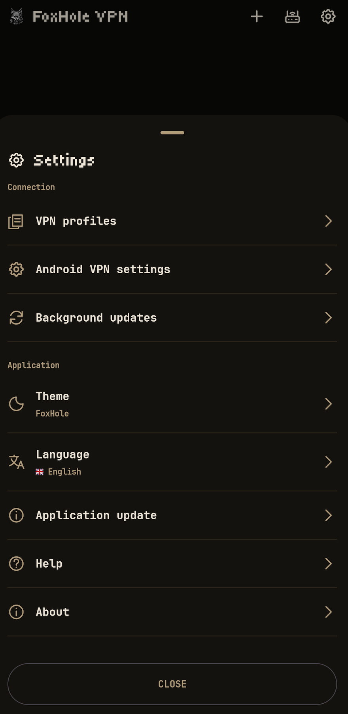

<p align="center">
    
</p>

<div align="center">

[](../README.md)
[](README.ru.md)
[](README.de.md)
[](README.fr.md)
[](README.es.md)
[](README.ja.md)
[](README.zh-CN.md)

</div>

<p align="center">
  <a href="https://github.com/foxhole-team/foxhole-vpn/releases">
    
  </a>
  <a href="https://f-droid.org/packages/com.foxhole.vpn/">
    
  </a>
  <a href="https://apps.obtainium.imranr.dev/redirect?r=obtainium://app/%7B%22id%22%3A%22com.foxhole.vpn%22%2C%22url%22%3A%22https%3A%2F%2Fgithub.com%2Ffoxhole-team%2Ffoxhole-vpn%22%2C%22author%22%3A%22FoxHole%20Team%22%2C%22name%22%3A%22FoxHole%20VPN%22%2C%22preferredApkIndex%22%3A0%2C%22additionalSettings%22%3A%22%7B%5C%22apkFilterRegEx%5C%22%3A%5C%22arm64-v8a-release%5C%5C%5C%5C.apk%24%5C%22%2C%5C%22invertAPKFilter%5C%22%3Afalse%2C%5C%22verifyLatestTag%5C%22%3Atrue%7D%22%2C%22overrideSource%22%3A%22GitHub%22%7D">
    
  </a>
</p>

# FoxHole VPN

[](https://github.com/foxhole-team/foxhole-vpn)


<p align="center">
  
  
  
</p>

FoxHole VPN est un client VPN simple pour Android 8 et versions ultérieures. Importez un profil de votre fournisseur VPN ou de votre serveur, connectez votre téléphone et gérez un routeur OpenWrt associé depuis l’application.

Prend en charge VLESS, VMess, Trojan, Shadowsocks/Outline, WireGuard, AmneziaWG (expérimental), Hysteria2, Naive, TUIC et AnyTLS. Importe les configurations FoxHole Guard compatibles, les liens et abonnements v2rayTun, le YAML Clash/mihomo, le JSON SIP008 et les clés dynamiques Outline (`ssconf://`). Partagez uniquement avec des personnes de confiance : les profils exportés et leurs liens sources peuvent contenir des identifiants.

## 🤖 Plateformes prises en charge

Android 8 (API 26) ou ultérieur est requis. Les profils de compilation peuvent inclure `arm64-v8a`, `armeabi-v7a`, `x86` et `x86_64` ; chaque version publiée indique les APK disponibles.

La politique actuelle des paquets et mises à jour du routeur admet OpenWrt 25.12.5 avec `mediatek/filogic` et `x86/64`, sous réserve d’un catalogue authentifié pour l’architecture exacte, de dépendances et d’une ABI du noyau compatibles, et d’assez de mémoire flash/RAM. Un nom de cible ne valide pas tous les modèles de routeur.

## 🎛️ Commandes au quotidien

- Importez des profils depuis le presse-papiers, un fichier ou un code QR ; partagez les profils enregistrés et actualisez ceux qui conservent une source d’abonnement.
- Choisissez un protocole parmi les options d’un profil importé. Le changement de protocole du profil actif demande confirmation avant la reconnexion.
- Les widgets de l’écran d’accueil affichent l’état de connexion et permettent de démarrer ou d’arrêter le profil sélectionné.
- Choisissez le thème et la langue dans les paramètres : anglais, russe, allemand, français, espagnol, japonais ou chinois simplifié.

Si activés dans Paramètres → Mises à jour en arrière-plan, les abonnements sont actualisés par défaut environ toutes les 12 heures et les données de connexion signées de FoxHole DB sont vérifiées toutes les 24 heures. Chaque vérification peut y être désactivée séparément. L’installation des données exige toujours votre action. La version GitHub recherche une mise à jour de l’application chaque jour ; le téléchargement et l’installation d’un APK exigent votre action et une confirmation Android. La version F-Droid ne recherche ni n’installe ses propres mises à jour APK : utilisez F-Droid. Android peut retarder les tâches en arrière-plan.

## 🛜 Gestion du routeur (bêta publique)

La gestion du routeur est en bêta publique. La compatibilité des appareils ainsi que l’installation et les mises à jour sont encore en cours de validation.

> [!IMPORTANT]
> L’installation automatique est actuellement prise en charge uniquement sur les routeurs dont la configuration OpenWrt est entièrement celle par défaut.
> L’association est aussi possible après l’installation manuelle de la dernière version de [FoxHole OpenWrt Client](https://github.com/foxhole-team/foxhole-openwrt-client).
> Pour l’installation et l’association, le téléphone et le routeur doivent être sur le même réseau local, et le routeur doit avoir accès à Internet.

`ACCESS_LOCAL_NETWORK` - recherche, configuration et gestion des routeurs. Sous Android 17 (API 37) ou ultérieur, si l’application cible l’API 37 ou ultérieure, elle demande l’autorisation système avant les actions LAN. Un refus bloque ces actions.

L’interrupteur de gestion concerne l’association enregistrée sélectionnée. Le désactiver arrête la gestion depuis l’application, pas le VPN du routeur ; la configuration et l’association restent disponibles pour un routeur non associé.

L’icône Wi-Fi indique uniquement une connexion Wi-Fi physique, sans SSID ni accès à la localisation. La recherche et toute nouvelle configuration/association exigent le Wi-Fi. L’adresse manuelle est préremplie une fois avec la passerelle IPv4 privée du Wi-Fi actuel, si disponible, et reste modifiable.

Gérer via le VPN domestique est un choix distinct, DÉSACTIVÉ par défaut pour chaque association existante. Il exige aussi votre confirmation Adresse IP publique (le routeur possède une IP publique et un service VPN entrant) et une route VPN active utilisable. Cette confirmation n’attribue aucune adresse et ne configure pas le pare-feu. L’application peut tenter la gestion à l’adresse privée enregistrée via ce réseau VPN avec l’identité TLS épinglée et l’authentification associée existantes ; elle n’ouvre aucun port de gestion WAN et ne permet pas de nouvelle recherche/association via le réseau mobile. Le basculement/handoff automatique du VPN du téléphone reste désactivé ; ce choix concerne uniquement la gestion du routeur.

Seuls les profils VPN entrants transmis directement à l’application par un routeur associé et authentifié reçoivent des métadonnées distinctes de liaison avec l’application. URI de connexion, configuration et formats QR restent inchangés. Les exports génériques web/QR/fournisseurs restent sans marque ; des indications importées ne créent pas de confiance à elles seules.

La reconnaissance automatique exige aussi le profil local enregistré correspondant, sa configuration actuelle et l’association sélectionnée, avec ce profil réellement connecté via le VPN de l’application. Une vérification bornée est effectuée par connexion réelle, sans minuteur, nouvelle tentative automatique ni interrogation des profils fournisseurs. Réessayer l’association est une procédure explicite Wi-Fi/autorisation/PIN : l’ancien enregistrement est conservé jusqu’à l’authentification réussie, sans accepter silencieusement une identité de certificat différente.

Avant la première installation sur le routeur, lisez et acceptez explicitement l’accord FoxHole OpenWRT Client. Ce choix est désactivé au départ et séparé des mises à jour automatiques. Aucun consentement rétroactif n’est demandé pour les routeurs déjà associés.

Installez le paquet [FoxHole OpenWrt Client](https://github.com/foxhole-team/foxhole-openwrt-client) pour gérer les profils VPN, les routes des appareils et les paquets de protocoles du routeur. La configuration nécessite OpenWrt 25.12.5 avec le gestionnaire de paquets apk et un catalogue de version authentifié pour l’architecture exacte du routeur ; elle vérifie aussi l’espace libre. Les catalogues publiés déterminent les cibles disponibles. Un accès administrateur est nécessaire. Les profils VPN de vos appareils hors du domicile nécessitent une adresse publique du routeur joignable et un VPN entrant configuré. Vérifiez l’accès depuis un réseau mobile.

Lors d’une nouvelle installation sur le routeur, la case visible des mises à jour automatiques FoxHole est initialement cochée. Décochez-la pour refuser ou modifiez la politique ensuite dans les réglages du routeur. Si elle est activée, le routeur vérifie chaque jour et installe les mises à jour vérifiées des paquets depuis les versions FoxHole, indépendamment de F-Droid. L’association d’un routeur existant conserve sa politique. Les profils et l’association sont conservés ; le micrologiciel OpenWrt et les autres paquets système ne sont pas mis à jour. Dissocier le téléphone ne désactive pas cette politique du routeur.

Les mises à jour manuelles de FoxHole depuis l’application et LuCI utilisent la même transaction authentifiée. Les installations directes par CLI/backend gardent les mises à jour automatiques désactivées par défaut.

## 🔒 Confidentialité

Les profils et réglages sont chiffrés sur l’appareil avec une clé Android Keystore. Aucun SDK publicitaire ou d’analyse. Les vérifications VPN contactent `www.google.com/generate_204` ; les données de l’IP de sortie proviennent de `ipwho.is`. Ces requêtes utilisent le réseau VPN sélectionné. Sans VPN, la position approximative peut être actualisée via la connexion Internet actuelle, y compris par un widget. Les services reçoivent la requête et son IP source. Les données de connexion signées proviennent de `foxhole-team.github.io/foxhole-db` ; les abonnements utilisent les URL enregistrées du fournisseur. Le GPS n’est pas nécessaire.

## 📄 Licence

[GPL-3.0-or-later](../LICENSE) · Copyright (C) 2026 FOXHOLE TEAM.

Les licences des composants figurent dans Paramètres → À propos.

[Composants tiers](../THIRD_PARTY_NOTICES.md).

## 🔗 Projets associés

[](https://github.com/foxhole-team/foxhole-core)
[](https://github.com/foxhole-team/foxhole-core/releases)

[](https://github.com/foxhole-team/foxhole-db)
[](https://github.com/foxhole-team/foxhole-db/releases)

[](https://github.com/foxhole-team/foxhole-guard)
[](https://github.com/foxhole-team/foxhole-guard/releases)

[](https://github.com/foxhole-team/foxhole-openwrt-client)
[](https://github.com/foxhole-team/foxhole-openwrt-client/releases)

## 📦 Disponibilité des versions

Chaque version publiée indique les architectures APK et les cibles de routeur disponibles. Une option de compilation ou une recette source ne prouve ni la compatibilité avec un appareil ni la disponibilité sur F-Droid ; l’inclusion sur F-Droid reste soumise à son examen.

## 💖 Soutenir le développement

Nous développons et maintenons FoxHole VPN entièrement avec notre propre temps et nos propres ressources, avec l’aide d’outils d’IA. Votre soutien nous aide à consacrer plus de temps au projet et à accélérer le développement.

[Soutenir le projet - portefeuilles de cryptomonnaies](#cryptocurrency-wallets)

<a id="cryptocurrency-wallets"></a>

### 🪙 Portefeuilles de cryptomonnaies

**XMR (Monero):**

```text
48yBVPTdcyJ1WoJtnKmVpEZziEsDy4HvbCW7eQDS9mfdiWPFXwZ8F5h9YZ2UTTBLxPcJgQgvth7iqLZM2yMCaQ432qaouqr
```

**BTC (Bitcoin):**

```text
bc1qatnyy7jcpqrp0d3dk9rta9vqfejgh4mysd6m2f
```

**ETH (Ethereum):**

```text
0xDEBA357Cc8f5E865ea7FFa98E138C8241A16A465
```
