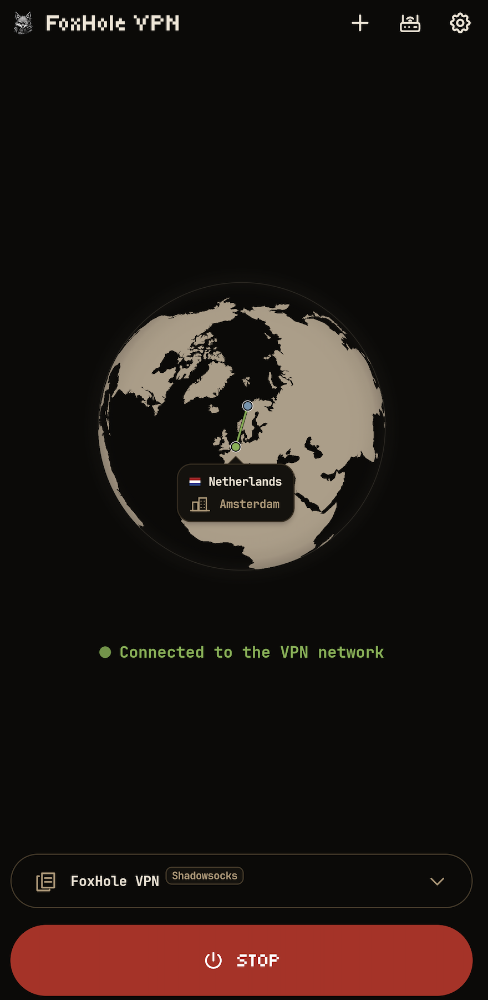

<p align="center">
    
</p>

<div align="center">

[](../README.md)
[](README.ru.md)
[](README.de.md)
[](README.fr.md)
[](README.es.md)
[](README.ja.md)
[](README.zh-CN.md)

</div>

<p align="center">
  <a href="https://github.com/foxhole-team/foxhole-vpn/releases">
    
  </a>
  <a href="https://f-droid.org/packages/com.foxhole.vpn/">
    
  </a>
  <a href="https://apps.obtainium.imranr.dev/redirect?r=obtainium://app/%7B%22id%22%3A%22com.foxhole.vpn%22%2C%22url%22%3A%22https%3A%2F%2Fgithub.com%2Ffoxhole-team%2Ffoxhole-vpn%22%2C%22author%22%3A%22FoxHole%20Team%22%2C%22name%22%3A%22FoxHole%20VPN%22%2C%22preferredApkIndex%22%3A0%2C%22additionalSettings%22%3A%22%7B%5C%22apkFilterRegEx%5C%22%3A%5C%22arm64-v8a-release%5C%5C%5C%5C.apk%24%5C%22%2C%5C%22invertAPKFilter%5C%22%3Afalse%2C%5C%22verifyLatestTag%5C%22%3Atrue%7D%22%2C%22overrideSource%22%3A%22GitHub%22%7D">
    
  </a>
</p>

# FoxHole VPN

[](https://github.com/foxhole-team/foxhole-vpn)


<p align="center">
  
  
  
</p>

FoxHole VPNはAndroid 8以降向けのシンプルなVPNクライアントです。VPNプロバイダーまたは自分のサーバーのプロファイルをインポートし、電話を接続して、ペアリング済みOpenWrtルーターをアプリから管理できます。

VLESS、VMess、Trojan、Shadowsocks/Outline、WireGuard、AmneziaWG（試験的サポート）、Hysteria2、Naive、TUIC、AnyTLSに対応します。互換性のあるFoxHole Guard設定、v2rayTunリンクとサブスクリプション、Clash/mihomo YAML、SIP008 JSON、Outline動的キー（`ssconf://`）をインポートできます。エクスポートしたプロファイルや参照リンクには認証情報が含まれる場合があります。信頼できる相手とのみ共有してください。

## 🤖 対応プラットフォーム

Android 8（API 26）以降が必要です。ビルドプロファイルには `arm64-v8a`、`armeabi-v7a`、`x86`、`x86_64` を含められます。利用できる APK は各公開リリースに記載されます。

現在のルーターパッケージ・更新ポリシーは、OpenWrt 25.12.5 の `mediatek/filogic` と `x86/64` を対象とします。正確なアーキテクチャの認証済みカタログ、対応する依存関係とカーネル ABI、十分なフラッシュ/RAM が必要です。対象名だけではすべてのルーターモデルとの互換性を証明できません。

## 🎛️ 日常の操作

- クリップボード、ファイル、QRコードからプロファイルをインポートし、保存済みプロファイルを共有できます。サブスクリプションの参照元を保持するプロファイルは更新できます。
- インポートしたプロファイルの選択肢からプロトコルを選べます。使用中のプロファイルのプロトコル変更には、再接続前の確認が必要です。
- ホーム画面のウィジェットで接続状態を確認し、選択したプロファイルを開始・停止できます。
- 設定でテーマと言語を選べます。英語、ロシア語、ドイツ語、フランス語、スペイン語、日本語、簡体字中国語に対応します。

設定 → バックグラウンド更新で有効にすると、既定ではサブスクリプションを約12時間ごとに更新し、FoxHole DBの署名付き接続データを24時間ごとに確認します。各確認は同じ画面で個別にオフにできます。データのインストールには引き続き操作が必要です。GitHub版は毎日アプリの更新を確認します。APKのダウンロードとインストールには操作とAndroidの確認が必要です。F-Droid版は独自のAPK更新を確認・インストールしません。F-Droidをご利用ください。Androidがバックグラウンド処理を遅らせることがあります。

## 🛜 ルーター管理（パブリックベータ）

ルーター管理はパブリックベータ版です。端末の互換性とインストール・更新手順は検証中です。

> [!IMPORTANT]
> 現在、自動インストールに対応するのは、OpenWrt の設定がすべて初期値のルーターのみです。
> 最新の [FoxHole OpenWrt Client](https://github.com/foxhole-team/foxhole-openwrt-client) を手動でインストールしたルーターともペアリングできます。
> セットアップとペアリングには、スマートフォンとルーターが同じ LAN に接続され、ルーターからインターネットにアクセスできる必要があります。

`ACCESS_LOCAL_NETWORK` - ルーターの検索、設定、管理に使用します。Android 17（API 37）以降でアプリの対象 API も 37 以降の場合、LAN 操作の前にシステム権限を要求します。拒否すると該当する操作は行えません。

管理スイッチは選択した保存済みペアリングに適用されます。オフにするとアプリからの管理を止めますが、ルーターの VPN は停止しません。未ペアリングのルーターでも初期設定とペアリングは利用できます。

Wi-Fi アイコンは物理的な Wi-Fi 接続のみを示し、SSID や位置情報へのアクセスは使いません。検索と新規設定・ペアリングには Wi-Fi が必要です。手動入力には利用可能な現在の Wi-Fi のプライベート IPv4 ゲートウェイが一度だけ入り、その後も編集できます。

自宅 VPN 経由で管理は独立した選択で、既存のペアリングごとに既定でオフです。公開 IP アドレスの確認（ルーターに公開 IP と受信 VPN サービスがあるという利用者の申告）と、利用可能なアクティブ VPN 経路も必要です。この確認はアドレスの割り当てやファイアウォール設定を行いません。アプリはその VPN ネットワーク経由で保存済みのプライベート接続先に、既存の固定 TLS 識別情報とペアリング認証で管理を試みます。WAN 管理ポートを開いたり、モバイル回線で新たに検索・ペアリングしたりはしません。 電話の VPN 自動切替・ハンドオフは引き続き無効です。この選択はルーター管理だけに適用されます。

認証済みのペアリング済みルーターからアプリへ直接届く受信 VPN プロファイルにのみ、独立したアプリ連携メタデータが付きます。接続 URI、設定、QR 形式は変わりません。一般のウェブ・QR・プロバイダーのエクスポートには付きません。インポートしたヒントだけでは信頼を確立できません。

自動認識には、保存済みローカルプロファイル、現在の設定、選択したペアリングの一致に加え、そのプロファイルがアプリ自身の VPN で実際に接続中であることも必要です。実際の接続ごとに時間制限付き確認を一度行い、タイマー、自動再試行、プロバイダープロファイルの定期照会はありません。ペアリングを再試行は Wi-Fi・権限・PIN を使う明示的な手順です。認証成功までは元の記録を保持し、変更された証明書の識別情報を自動承認しません。

ルーターへの初回インストール前に、FoxHole OpenWRT Client の同意事項を読み、明示的に同意してください。同意欄は初期状態では未選択で、自動更新とは別の設定です。既にペアリング済みのルーターに遡って同意を求めることはありません。

[FoxHole OpenWrt Client](https://github.com/foxhole-team/foxhole-openwrt-client)パッケージをインストールすると、ルーターのVPNプロファイル、端末ルーティング、プロトコルパッケージを管理できます。設定には、パッケージマネージャーapkを使用するOpenWrt 25.12.5と、ルーターの正確なアーキテクチャに対応した認証済みリリースカタログが必要です。空き容量も検証します。利用可能な対象は公開カタログによって決まります。ルーターの管理者権限が必要です。外出先で自分の端末からVPNに接続するには、到達可能なルーターの公開アドレスと設定済みの受信VPNが必要です。モバイル回線から到達性を確認してください。

ルーターへの新規インストールでは、表示されるFoxHole自動更新のチェックボックスが最初からオンになっています。オフにするか、後からルーター設定で変更できます。有効な場合、ルーターは毎日確認し、F-Droidとは別にFoxHoleリリースの検証済みパッケージ更新をインストールします。既存ルーターとのペアリングでは既存の設定を保持します。プロファイルとペアリングは保持され、OpenWrtファームウェアや他のシステムパッケージは更新しません。電話のペアリングを解除しても、この更新設定は無効になりません。

アプリと LuCI からの FoxHole 手動更新は同じ認証付きトランザクションを使います。CLI/backend から直接インストールした場合、自動更新は既定でオフです。

## 🔒 プライバシー

プロファイルと設定はAndroid Keystoreの鍵で端末上に暗号化されます。広告や解析SDKは含まれません。VPN確認には`www.google.com/generate_204`を使用し、出口IPの情報は`ipwho.is`から取得します。これらのリクエストは選択したVPNネットワークを使用します。VPNがオフのときは、ウィジェットを含め、現在のインターネット接続でおおよその端末位置を更新できます。各サービスはリクエストと送信元IPを受け取ります。署名付き接続データは`foxhole-team.github.io/foxhole-db`、サブスクリプションは保存済みプロバイダーURLから取得します。GPSは不要です。

## 📄 ライセンス

[GPL-3.0-or-later](../LICENSE) · Copyright (C) 2026 FOXHOLE TEAM.

コンポーネントのライセンスは「設定 → このアプリについて」で確認できます。

[サードパーティー製コンポーネント](../THIRD_PARTY_NOTICES.md).

## 🔗 関連プロジェクト

[](https://github.com/foxhole-team/foxhole-core)
[](https://github.com/foxhole-team/foxhole-core/releases)

[](https://github.com/foxhole-team/foxhole-db)
[](https://github.com/foxhole-team/foxhole-db/releases)

[](https://github.com/foxhole-team/foxhole-guard)
[](https://github.com/foxhole-team/foxhole-guard/releases)

[](https://github.com/foxhole-team/foxhole-openwrt-client)
[](https://github.com/foxhole-team/foxhole-openwrt-client/releases)

## 📦 リリースの提供状況

利用できるAPKのアーキテクチャとルーターの対象は、各公開リリースに記載されます。ビルド設定やソースレシピだけでは、端末との互換性やF-Droidでの提供を証明できません。F-Droidへの収録には同プロジェクトの審査が必要です。

## 💖 開発を支援する

私たちはAIツールの助けを借りながら、すべて自分たちの時間と資源でFoxHole VPNを開発・保守しています。皆さまのご支援により、プロジェクトにより多くの時間を充て、開発を加速できます。

[プロジェクトを支援する - 暗号資産ウォレット](#cryptocurrency-wallets)

<a id="cryptocurrency-wallets"></a>

### 🪙 暗号資産ウォレット

**XMR (Monero):**

```text
48yBVPTdcyJ1WoJtnKmVpEZziEsDy4HvbCW7eQDS9mfdiWPFXwZ8F5h9YZ2UTTBLxPcJgQgvth7iqLZM2yMCaQ432qaouqr
```

**BTC (Bitcoin):**

```text
bc1qatnyy7jcpqrp0d3dk9rta9vqfejgh4mysd6m2f
```

**ETH (Ethereum):**

```text
0xDEBA357Cc8f5E865ea7FFa98E138C8241A16A465
```
