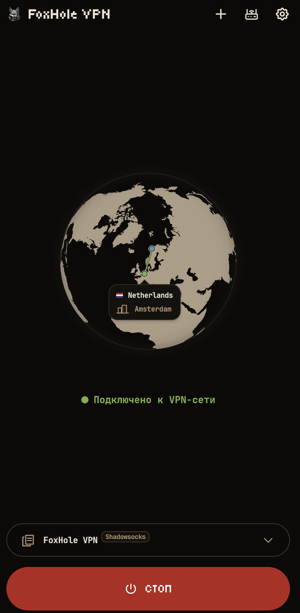
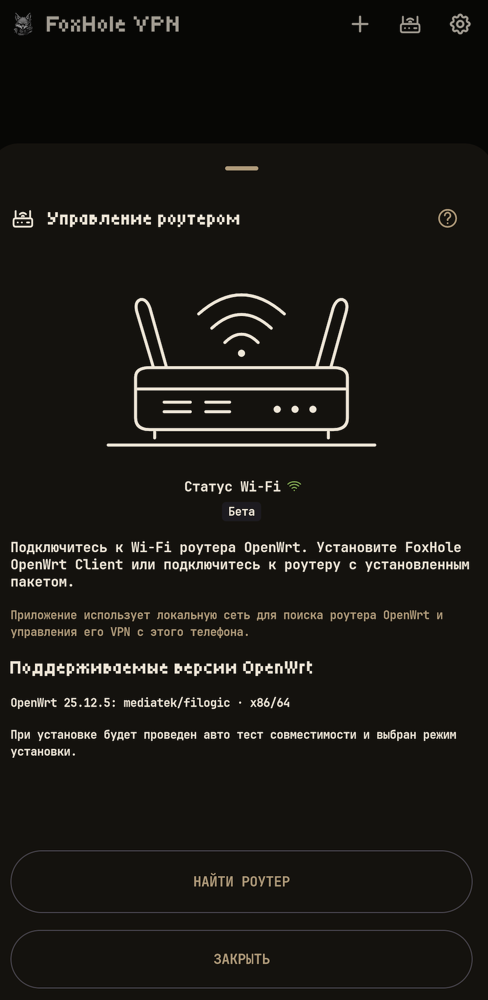
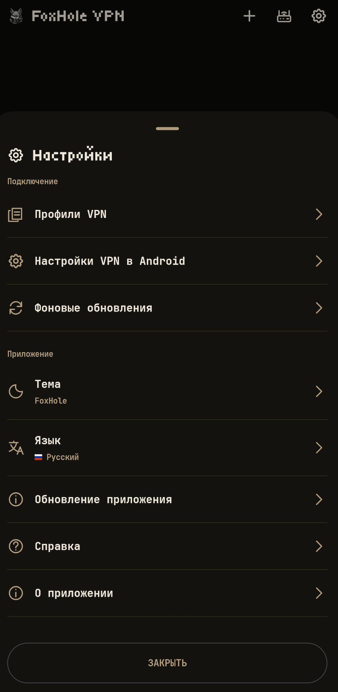

<p align="center">
    
</p>

<div align="center">

[](../README.md)
[](README.ru.md)
[](README.de.md)
[](README.fr.md)
[](README.es.md)
[](README.ja.md)
[](README.zh-CN.md)

</div>

<p align="center">
  <a href="https://github.com/foxhole-team/foxhole-vpn/releases">
    
  </a>
  <a href="https://f-droid.org/packages/com.foxhole.vpn/">
    
  </a>
  <a href="https://apps.obtainium.imranr.dev/redirect?r=obtainium://app/%7B%22id%22%3A%22com.foxhole.vpn%22%2C%22url%22%3A%22https%3A%2F%2Fgithub.com%2Ffoxhole-team%2Ffoxhole-vpn%22%2C%22author%22%3A%22FoxHole%20Team%22%2C%22name%22%3A%22FoxHole%20VPN%22%2C%22preferredApkIndex%22%3A0%2C%22additionalSettings%22%3A%22%7B%5C%22apkFilterRegEx%5C%22%3A%5C%22arm64-v8a-release%5C%5C%5C%5C.apk%24%5C%22%2C%5C%22invertAPKFilter%5C%22%3Afalse%2C%5C%22verifyLatestTag%5C%22%3Atrue%7D%22%2C%22overrideSource%22%3A%22GitHub%22%7D">
    
  </a>

</p>

# FoxHole VPN

[](https://github.com/foxhole-team/foxhole-vpn)


<p align="center">
  
  
  
</p>

FoxHole VPN - простой VPN-клиент для Android 8 и новее. Импортируйте профиль своего VPN-провайдера или сервера, подключайтесь с телефона и управляйте сопряжённым роутером OpenWrt из приложения.

Поддерживаются VLESS, VMess, Trojan, Shadowsocks/Outline, WireGuard, AmneziaWG (экспериментальная поддержка), Hysteria2, Naive, TUIC и AnyTLS. Импортируются совместимые конфигурации FoxHole Guard, ссылки и подписки v2rayTun, Clash/mihomo YAML, SIP008 JSON и динамические ключи Outline (`ssconf://`). Делитесь профилями только с теми, кому доверяете: экспортируемые профили и ссылки на источник могут содержать данные доступа.

## 🤖 Поддерживаемые платформы

Требуется Android 8 (API 26) или новее. Варианты сборки могут включать `arm64-v8a`, `armeabi-v7a`, `x86` и `x86_64`; доступные APK перечислены в каждом опубликованном выпуске.

Текущая политика пакетов и обновлений роутера допускает OpenWrt 25.12.5 на `mediatek/filogic` и `x86/64` при наличии подтверждённого каталога для точной архитектуры, подходящих зависимостей и ABI ядра, достаточных flash/RAM. Название платформы не подтверждает совместимость с каждой моделью роутера.

## 🎛️ Возможности

- Импортируйте профили из буфера обмена, файла или QR-кода; делитесь сохранёнными профилями и обновляйте профили с сохранённым источником подписки.
- Виджеты главного экрана.
- Поддерживаются следующие языки приложения: английский, русский, немецкий, французский, испанский, японский и упрощённый китайский.

Если включено в разделе «Настройки → Фоновые обновления», по умолчанию подписки обновляются примерно раз в 12 часов, а подписанные данные подключения FoxHole DB проверяются раз в сутки. Обе фоновые проверки можно отключить там отдельно. Установка данных по-прежнему требует вашего действия. GitHub-сборка ежедневно проверяет новую версию приложения; загрузка и установка APK требуют вашего действия и подтверждения Android. Сборка F-Droid не проверяет и не устанавливает собственные обновления APK: используйте F-Droid. Android может откладывать фоновые задачи.

## 🛜 Публичная бета-версия управления роутером

Управление роутером - публичная бета-версия; совместимость устройств и сценарии установки и обновления ещё проверяются.

> [!IMPORTANT]
> Автоматическая установка сейчас поддерживается только на роутерах с полностью стандартной конфигурацией OpenWrt.
> Сопряжение также возможно после ручной установки актуальной версии [FoxHole OpenWrt Client](https://github.com/foxhole-team/foxhole-openwrt-client).
> Для установки и сопряжения телефон и роутер должны находиться в одной локальной сети; роутеру нужен доступ к интернету.

`ACCESS_LOCAL_NETWORK` - поиск, настройка и управление роутером. На Android 17 (API 37) и новее, если приложение рассчитано на API 37 и новее, системное разрешение запрашивается до действий в LAN. Отказ блокирует эти действия.

Переключатель управления относится к выбранному сохранённому сопряжению. Его выключение прекращает управление из приложения, но не останавливает VPN роутера; настройка и сопряжение несопряжённого роутера остаются доступны.

Значок Wi-Fi показывает только физическое подключение, без SSID и доступа к геолокации. Поиск и новая настройка/сопряжение требуют Wi-Fi. В ручной ввод однократно подставляется частный IPv4-шлюз текущей сети Wi-Fi, если он доступен; адрес можно изменить.

«Управление через домашний VPN» - отдельный выбор, по умолчанию ВЫКЛЮЧЕННЫЙ для каждого существующего сопряжения. Также нужны ваша отметка «Публичный IP-адрес» (у роутера есть публичный IP и входящий VPN-сервис) и подходящий активный маршрут VPN. Эта отметка не назначает адрес и не настраивает firewall. Приложение может попытаться через эту VPN-сеть управлять сохранённым частным адресом с прежним закреплённым TLS-сертификатом и авторизацией сопряжения; WAN-порт управления не открывается, поиск и новое сопряжение через мобильную сеть не добавляются. Автоматическое переключение/handoff VPN телефона остаётся отключённым; этот выбор относится только к управлению роутером.

Отдельные метаданные связи с приложением получают только профили входящего VPN, переданные прямо в приложение аутентифицированным сопряжённым роутером. URI подключения, конфигурация и формат QR не меняются. Обычные web/QR-экспорты и профили провайдеров остаются без метки; импортированная подсказка сама по себе не создаёт доверие.

Автоматическое распознавание дополнительно требует совпадения сохранённого локального профиля, текущей конфигурации и выбранного сопряжения, причём этот профиль должен реально работать через VPN самого приложения. На фактическое подключение выполняется одна ограниченная проверка, без таймера, автоматических повторов и опроса профилей провайдеров. «Повторить сопряжение» - явный сценарий Wi-Fi/разрешения/PIN: старая запись сохраняется до успешной аутентификации, новый TLS-сертификат не принимается молча.

Перед первой установкой на роутер прочитайте соглашение FoxHole OpenWRT Client и явно примите его. Изначально согласие не отмечено; оно отдельно от автоматических обновлений. Для уже сопряжённых роутеров повторного согласия не требуется.

Установите пакет [FoxHole OpenWrt Client](https://github.com/foxhole-team/foxhole-openwrt-client), чтобы управлять VPN-профилями, маршрутами устройств и пакетами протоколов на роутере. Для установки нужны OpenWrt 25.12.5 с пакетным менеджером apk и подтверждённый каталог выпуска для точной архитектуры роутера. Доступные платформы определяются опубликованными каталогами; также проверяется свободное место. Нужен доступ администратора роутера. Для VPN-профилей своих устройств вне дома необходимы доступный публичный адрес роутера и настроенный входящий VPN. Проверьте доступность через мобильную сеть.

При новой установке на роутер видимый флажок автоматического обновления FoxHole изначально включён. Снимите его для отказа или измените политику позже в настройках роутера. Если включено, роутер раз в сутки проверяет и устанавливает проверенные обновления пакетов из выпусков FoxHole OpenWrt Client. Сопряжение с существующим роутером сохраняет его настройки. Обновления сохраняют профили и сопряжение, не обновляют прошивку OpenWrt или посторонние системные пакеты. Снятие сопряжения телефона не меняет настройки роутера.

Ручные обновления FoxHole из приложения и LuCI используют одну подтверждённую транзакцию. При прямой установке через CLI/backend автоматическое обновление по умолчанию выключено.

## 🔒 Приватность

Профили и настройки зашифрованы на устройстве с ключом Android Keystore. Рекламного и аналитического SDK нет. Проверка VPN обращается к `www.google.com/generate_204`, а сведения о выходном IP получает от `ipwho.is`; эти запросы идут через выбранную VPN-сеть. Когда VPN отключён, приблизительное местоположение устройства может обновляться через текущее интернет-подключение, в том числе виджетом. Сервисы получают запрос и исходящий IP-адрес. Подписанные данные подключения поступают с `foxhole-team.github.io/foxhole-db`, подписки - по сохранённым адресам провайдера. Геолокация GPS не используется.

## 📄 Лицензия

[GPL-3.0-or-later](../LICENSE) · Copyright (C) 2026 FOXHOLE TEAM.

Лицензии компонентов перечислены в разделе «Настройки → О приложении».

[Сторонние компоненты](../THIRD_PARTY_NOTICES.md).

## 🔗 Связанные проекты

[](https://github.com/foxhole-team/foxhole-core)
[](https://github.com/foxhole-team/foxhole-core/releases)

[](https://github.com/foxhole-team/foxhole-db)
[](https://github.com/foxhole-team/foxhole-db/releases)

[](https://github.com/foxhole-team/foxhole-guard)
[](https://github.com/foxhole-team/foxhole-guard/releases)

[](https://github.com/foxhole-team/foxhole-openwrt-client)
[](https://github.com/foxhole-team/foxhole-openwrt-client/releases)

## 📦 Доступность выпусков

Доступные архитектуры APK и платформы роутеров перечислены в каждом опубликованном выпуске. Вариант сборки или рецепт из исходников сами по себе не подтверждают совместимость с устройством или доступность в F-Droid; включение в F-Droid зависит от его проверки.

## 💖 Поддержать разработку

Мы разрабатываем и поддерживаем FoxHole VPN полностью за счёт собственного времени и ресурсов, с использованием ИИ. Ваша поддержка помогает нам уделять проекту больше времени и ускорять разработку.

[Поддержать проект - криптовалютные кошельки](#cryptocurrency-wallets)

<a id="cryptocurrency-wallets"></a>

### 🪙 Криптовалютные кошельки

**XMR (Monero):**

```text
48yBVPTdcyJ1WoJtnKmVpEZziEsDy4HvbCW7eQDS9mfdiWPFXwZ8F5h9YZ2UTTBLxPcJgQgvth7iqLZM2yMCaQ432qaouqr
```

**BTC (Bitcoin):**

```text
bc1qatnyy7jcpqrp0d3dk9rta9vqfejgh4mysd6m2f
```

**ETH (Ethereum):**

```text
0xDEBA357Cc8f5E865ea7FFa98E138C8241A16A465
```
