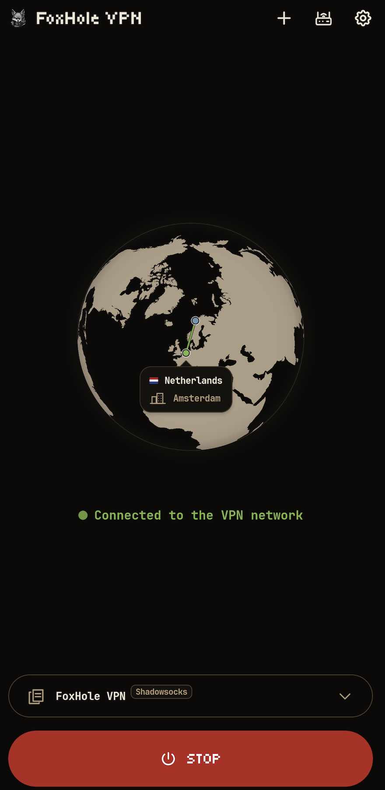
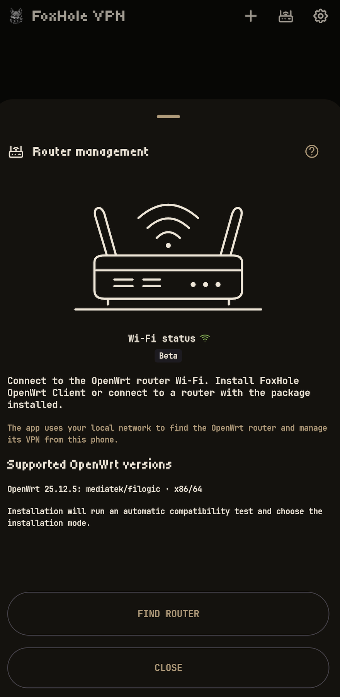
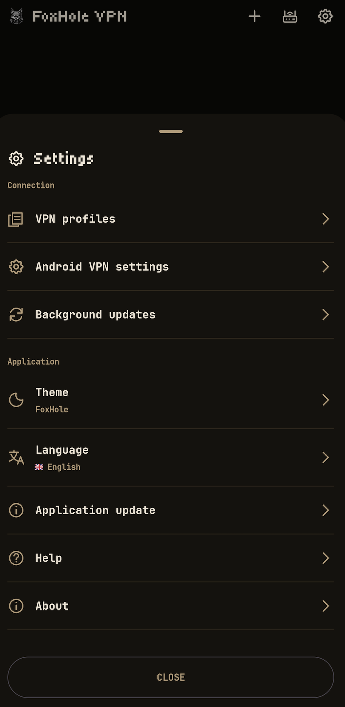

<h1 align="center">FoxHole VPN</h1>

<div align="center">

FoxHole VPN 是适用于 Android 8 及更高版本的简洁 VPN 客户端。导入 VPN 服务商或自有服务器的配置，在手机上连接，并从应用管理已配对的 OpenWrt 路由器。

</div>

<p align="center">
    
</p>

<div align="center">

[English](../README.md) · [Русский](README.ru.md) · [Deutsch](README.de.md) · [Français](README.fr.md) · [Español](README.es.md) · [日本語](README.ja.md) · [简体中文](README.zh-CN.md) · [العربية](README.ar.md)

</div>

<p align="center">
  <a href="https://github.com/foxhole-team/foxhole-vpn/releases">
    
  </a>
  
  <a href="https://f-droid.org/packages/com.foxhole.vpn/">
    
  </a>
  <a href="https://apps.obtainium.imranr.dev/redirect?r=obtainium://app/%7B%22id%22%3A%22com.foxhole.vpn%22%2C%22url%22%3A%22https%3A%2F%2Fgithub.com%2Ffoxhole-team%2Ffoxhole-vpn%22%2C%22author%22%3A%22FoxHole%20Team%22%2C%22name%22%3A%22FoxHole%20VPN%22%2C%22preferredApkIndex%22%3A0%2C%22additionalSettings%22%3A%22%7B%5C%22apkFilterRegEx%5C%22%3A%5C%22arm64-v8a%5B.%5Dapk%24%5C%22%2C%5C%22invertAPKFilter%5C%22%3Afalse%2C%5C%22verifyLatestTag%5C%22%3Atrue%7D%22%2C%22overrideSource%22%3A%22GitHub%22%7D" title="Obtainium · ARM64">
    
  </a>
</p>


支持 VLESS、VMess、Trojan、Shadowsocks/Outline、WireGuard、AmneziaWG（实验性支持）、Hysteria2、Naive、TUIC 和 AnyTLS。可导入兼容的 FoxHole Guard 配置、v2rayTun 链接和订阅、Clash/mihomo YAML、SIP008 JSON 及 Outline 动态密钥（`ssconf://`）。导出的配置和来源链接可能包含访问凭据，请仅与可信的人分享。

导入只转移支持的连接参数，不转移Clash/mihomo的规则和其他客户端设置，也不支持外部`proxy-providers`。Guard配置的兼容性仅针对VPN连接，不会转移Tor、I2P、防火墙或Guard场景。

<p align="center"><a href="#quickstart">开始使用</a> · <a href="#features">功能</a> · <a href="#details">详情</a> · <a href="#whats-new">更新内容</a></p>

<a id="whats-new"></a>

> **🆕 更新内容 - 1.0.4 Stable**
>
> - 新增阿拉伯语和RTL支持，适配了小组件，并修复了翻译和路由器设置。
> - 新增“路由”（测试版）板块，可轻松按应用配置流量路由，并以原子方式应用更改。
> - 修复了应用场景中的 DNS 路由。
> - 小组件现在会以颜色标识显示当前路由场景。
> - 优化了界面：修复了国旗显示、选择列表颜色和窗口动画。
> - 改进了所有支持语言的文档和帮助板块。
> - 新增应用日志。
> - 应用界面更加紧凑。
> - 新增应用新版本的系统通知（仅限 GitHub 版本）。

<a id="quickstart"></a>

## ⬇️ 开始使用与下载

需要Android 8（API 26）或更新版本。可用APK架构见各已发布版本。

1. 在[GitHub Releases](https://github.com/foxhole-team/foxhole-vpn/releases)选择APK架构。
2. 从文件、剪贴板或二维码导入自己的服务器或服务商配置。
3. 连接并确认Android的VPN请求。

Obtainium · ARM64。其他架构请在[GitHub Releases](https://github.com/foxhole-team/foxhole-vpn/releases)选择APK。

<p align="center">
  
  
  
</p>

## 🤖 支持的平台

需要 Android 8（API 26）或更高版本。构建配置可包含 `arm64-v8a`、`armeabi-v7a`、`x86` 和 `x86_64`；每个公开版本会列出可用 APK。

当前路由器软件包与更新策略允许 OpenWrt 25.12.5 的 `mediatek/filogic` 和 `x86/64`，但须有适用于准确架构的已认证目录、匹配的依赖关系与内核 ABI，以及足够的闪存/RAM。目标名称本身不能证明所有路由器型号均兼容。

## 📦 版本提供情况

每个公开版本会列出可用的 APK 架构和路由器目标。构建选项或源码构建配方本身不能证明设备兼容性或 F-Droid 可用性；是否收录仍须经过 F-Droid 审核。

<a id="features"></a>

## 🎛️ 日常操作

- 从剪贴板、文件或二维码导入配置；分享已保存的配置，并刷新保留订阅来源的配置。
- 从导入配置的选项中选择协议。更改当前配置的协议时，需要确认后才会重新连接。
- 主屏幕小组件显示连接状态，并可启动或停止选中的配置。
- 在设置中选择主题和应用语言：英语、俄语、德语、法语、西班牙语、日语或简体中文。

在“设置 → 后台更新”中启用后，默认大约每 12 小时刷新订阅，每 24 小时检查 FoxHole DB 的签名TLS指纹表。可在同一页面分别关闭这两项后台检查。安装数据仍需您的操作。GitHub 版本每天检查应用更新；下载和安装 APK 需要您的操作及 Android 确认。F-Droid 版本不会自行检查或安装 APK 更新，请使用 F-Droid。Android 可能延迟后台任务。

这些更新改变核心生成TLS ClientHello时使用的数据。安装已验证的更新需要用户操作。

<a id="details"></a>

## 🛜 路由器管理（公开测试版）

> [!NOTE]
> 暂不支持在 VPN 连接处于活动状态时管理路由器。

路由器管理现为公开测试版。设备兼容性以及安装和更新流程仍在验证中。

> [!IMPORTANT]
> 以下限制描述当前已发布版本。
> 目前，自动安装仅支持使用完全默认 OpenWrt 配置的路由器。
> 手动安装最新版 [FoxHole OpenWrt Client](https://github.com/foxhole-team/foxhole-openwrt-client) 后也可进行配对。
> 设置和配对时，手机和路由器必须位于同一局域网，且路由器需要能够访问互联网。

`ACCESS_LOCAL_NETWORK` - 用于发现、设置和管理路由器。在 Android 17（API 37）及更高版本上，若应用的目标 API 也是 37 或更高版本，会在 LAN 操作前请求系统权限。拒绝后会阻止这些操作。

管理开关仅适用于所选的已保存配对。关闭它会停止应用管理，但不会停止路由器 VPN；未配对路由器仍可进行初始设置和配对。

Wi-Fi 图标仅表示实际的 Wi-Fi 连接，不读取 SSID 或访问定位。搜索和新的设置/配对需要 Wi-Fi。手动地址会在可用时一次性填入当前 Wi-Fi 的私有 IPv4 网关，之后仍可编辑。

通过家庭 VPN 管理是独立选项，每个已有配对默认关闭。还需要您确认“公网 IP 地址”（路由器有公网 IP 和入站 VPN 服务），并具备可用的活动 VPN 路由。此确认不会分配地址或配置防火墙。应用可通过该 VPN 网络，使用已有的固定 TLS 身份和配对认证，尝试管理已保存的私有地址；不会开放 WAN 管理端口，也不会通过移动网络进行新的搜索或配对。 手机 VPN 的自动切换/交接仍然禁用；此选项仅用于管理路由器。

<details>
<summary>路由器管理详情</summary>

只有已配对且经过认证的路由器直接发送到应用的入站 VPN 配置，才带有独立的应用关联元数据。连接 URI、配置和 QR 格式均不改变。通用网页/QR/服务商导出仍不带标记；导入的提示本身不能建立信任。

自动识别还要求已保存的本地配置、当前配置内容及所选配对相匹配，且该配置确实通过应用自身的 VPN 连接。每次实际连接只进行一次有时间限制的检查，没有定时器、自动重试或服务商配置轮询。“重试配对”是明确的 Wi-Fi/权限/PIN 流程：认证成功前保留原有记录，绝不自动接受已改变的证书身份。

</details>

首次在路由器上安装前，请阅读并明确接受 FoxHole OpenWRT Client 协议。此选项默认不勾选，与自动更新独立。已配对的路由器无需追溯同意。

安装 [FoxHole OpenWrt Client](https://github.com/foxhole-team/foxhole-openwrt-client) 软件包后，可管理路由器 VPN 配置、设备路由和协议软件包。设置需要使用 apk 软件包管理器的 OpenWrt 25.12.5，以及适用于路由器准确架构的经过身份验证的发布目录；同时会检查可用空间。可用目标由公开的目录决定。安装需要路由器管理员权限。设备在外使用的 VPN 配置需要可访问的路由器公网地址及已配置的入站 VPN。请通过移动网络检查可达性。

首次在路由器安装时，可见的 FoxHole 自动更新复选框默认选中。可取消勾选，或稍后在路由器设置中修改。启用后，路由器每天检查并安装来自 FoxHole 发布的已验证软件包更新，与 F-Droid 独立。与已有路由器配对会保留其更新策略。更新会保留配置与配对，不升级 OpenWrt 固件或其他系统软件包。取消手机配对不会关闭路由器上的此更新策略。

应用与 LuCI 的 FoxHole 手动更新使用同一套经过身份验证的事务。通过 CLI/backend 直接安装时，自动更新默认关闭。

## 🔒 隐私

配置与设置使用 Android Keystore 密钥在设备上加密保存。不含广告或分析 SDK。VPN 检查会联系 `www.google.com/generate_204`，出口 IP 信息来自 `ipwho.is`；这些请求使用选中的 VPN 网络。VPN 关闭时，可通过当前互联网连接更新大致设备位置，包括从小组件发起的更新。这些服务会收到请求及其来源 IP。签名TLS指纹表来自 `foxhole-team.github.io/foxhole-db`；订阅使用已保存的服务商 URL。不需要 GPS。

<a id="ecosystem"></a>

## 🔗 FoxHole生态系统

| 项目 | 用途 |
| --- | --- |
| [FoxHole Guard](https://github.com/foxhole-team/foxhole-guard) | Android：VPN、Tor/I2P、流量规则和本地监控 |
| [**FoxHole VPN**](https://github.com/foxhole-team/foxhole-vpn) | Android：简洁VPN客户端及已配对OpenWrt管理 |
| [FoxHole Core](https://github.com/foxhole-team/foxhole-core) | 共用Rust网络核心；功能取决于构建 |
| [FoxHole OpenWrt](https://github.com/foxhole-team/foxhole-openwrt-client) | 路由器VPN及局域网管理 |
| [FoxHole DB](https://github.com/foxhole-team/foxhole-db) | 签名规则和参考数据 |

## 🤝 参与开发

请通过[Issues](https://github.com/foxhole-team/foxhole-vpn/issues)报告错误或提出修改建议。

## 💖 支持开发

我们完全利用自己的时间和资源开发和维护FoxHole VPN，并在开发中使用AI工具。您的支持能让我们为项目投入更多时间，加快开发进度。

<a id="cryptocurrency-wallets"></a>

### 🪙 加密货币钱包

**XMR (Monero):**

```text
48yBVPTdcyJ1WoJtnKmVpEZziEsDy4HvbCW7eQDS9mfdiWPFXwZ8F5h9YZ2UTTBLxPcJgQgvth7iqLZM2yMCaQ432qaouqr
```

**BTC (Bitcoin):**

```text
bc1qatnyy7jcpqrp0d3dk9rta9vqfejgh4mysd6m2f
```

**ETH (Ethereum):**

```text
0xDEBA357Cc8f5E865ea7FFa98E138C8241A16A465
```

## 📄 许可证

[GPL-3.0-or-later](../LICENSE) · Copyright (C) 2026 FOXHOLE TEAM.

组件许可证列于“设置 → 关于”。

[第三方组件](../THIRD_PARTY_NOTICES.md).
